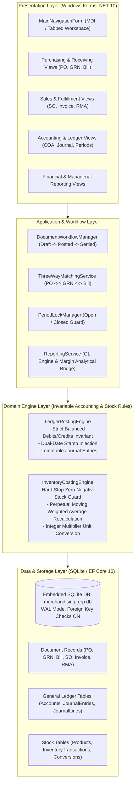
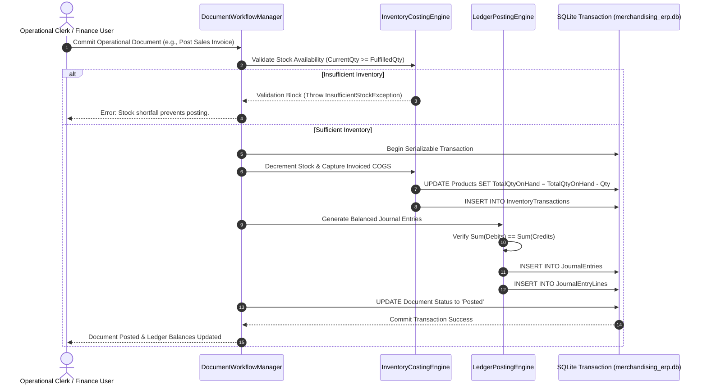

# MVP ERP Accounting System for Small-to-Mid Scale Merchandising Businesses

*   **Author:** Max Sainz
*   **Status:** Draft
*   **Date:** 2026-11-16

--------------------------------------------------------------------------------

## Overview

Small-to-mid scale merchandising businesses (including wholesale distributors, import-to-retail merchants, and packaged goods suppliers) face inventory discrepancies, margin distortions, unrecorded shrinkage, and delayed financial closes. In typical setups, physical warehouse operations (receiving, picking, packing, shipping, and handling returns) happen in spreadsheets or standalone warehouse software disconnected from the General Ledger. Bookkeepers record summary journal entries days or weeks later based on supplier bills and bank statements, leaving the business blind to true stock availability and actual product margins.

This system provides a document-driven, unified Enterprise Resource Planning (ERP) accounting architecture where warehouse operations and financial ledgers operate as a single system. Every operational transaction—receiving inventory, fulfilling sales orders, processing customer returns, and settling invoices—posts balanced double-entry accounting records immediately in real time.

## The Problem

Operating inventory movements independently of the financial ledger causes four critical points of failure:

1. **Phantom Inventory and Margin Distortions**: When sales systems lack real-time stock valuation or allow negative inventory, items are sold without an accurate Cost of Goods Sold (COGS). Financial reports show artificial profit spikes, followed by massive write-downs at month-end.
2. **Operational-to-Financial Disconnect (GRNI Lag)**: When goods arrive at the loading dock, warehouse staff need stock available immediately for sales fulfillment. However, vendor invoices frequently arrive weeks later with unexpected price adjustments or separate freight charges. Without a formal Goods Received Not Invoiced (GRNI) clearing mechanism, businesses either delay receiving (stalling sales) or fail to accrue liabilities accurately.
3. **Flawed Returns Management**: Customer returns often bypass quality control, putting damaged or opened goods back into active stock, or granting direct cash refunds without proper accounting verification, creating leakage and stock inaccuracy.
4. **Historical Restatements from Backdated Edits**: Standard bookkeeping software allows users to retroactively edit past transactions, which silently alters historical Trial Balances, invalidates previously closed accounting periods, and complicates tax compliance and audits.

The solution is an incorruptible, document-driven financial system enforcing strict non-negative inventory balances, perpetual moving average costing, forward-only variance expensing, and append-only ledger entries with dual-date tracking.

## Goals

* **Real-Time Balanced Financial Postings**: Generate balanced, double-entry General Ledger journal entries automatically whenever an operational document (Goods Receipt Note, Supplier Bill, Sales Invoice / Delivery Note, Customer Credit Note, Payment Voucher) is committed.
* **Hard-Stop Zero Negative Inventory Enforcement**: Enforce a strict validation check preventing the generation or posting of delivery notes and sales invoices if physical on-hand stock is insufficient, preventing negative inventory and undefined unit costing.
* **Perpetual Moving Weighted Average Costing**: Continuously update unit valuation and inventory asset balances upon each Goods Receipt, maintaining accurate inventory asset and COGS calculations without periodic manual count reconciliations.
* **Dual-Date Append-Only Ledger**: Record both an immutable `System Posting Timestamp` (governing the open financial period and statutory Trial Balance) and an `Operational Event Date` (capturing the physical occurrence time for operational event ordering), strictly preventing retroactive edits to closed periods.
* **Three-Way Matching via GRNI Clearing**: Value stock receipts at purchase order prices against `2100 GRNI`, and route supplier bill price differences and inbound freight directly to `5100 Purchase Price Variance` and `5200 Inbound Freight Variance` in the current open period.
* **Controlled Two-Stage Customer Returns**: Direct all customer returns into a quarantine location (`1350 Quarantine Inventory`) without initial financial impact, generating credit memos and restocking/scrapping journal entries only after physical inspection.
* **Core Financial and Operational Reporting**: Deliver instant standard financial statements (Balance Sheet, Income Statement / P&L, Trial Balance, Cash Flow) alongside operational reports (AR/AP Aging, Inventory Valuation, and Managerial Product Profitability).

## Non-Goals

* **Manufacturing and Production (BOM/WIP)**: No assembly orders, bill of materials, work-in-progress tracking, or labor overhead allocation.
* **Multi-Warehouse and Multi-Bin Routing**: No multi-site inventory transfers, in-transit stock routing, or bin/aisle-level warehouse management.
* **Multi-Currency and Foreign Exchange**: No foreign exchange gain/loss calculations, revaluations, or multi-currency bank accounts (all international purchases must be recorded in the local base currency using landed conversion amounts).
* **Variable / Catch-Weight Units**: No fractional or weight-variable conversion ratios; inventory tracking is strictly anchored to atomic integer Base Units with integer packaging multipliers.
* **Countertop Cash Refunds**: No point-of-sale cash payouts for customer returns without managerial authorization and accounts payable disbursement vouchers.
* **Retroactive Inventory Revaluation**: No restatement of past inventory cost layers or retroactive recalculation of closed period COGS.
* **Automated Direct Bank Feeds**: No direct open-banking API integration or automated transaction parsing; bank reconciliation uses imported statements and manual match verification.

## Open Questions

* **Open Question 1**: How should the system handle Partial Goods Receipts where a vendor delivers 80% of an order and cancels the remaining 20%? Does the Purchase Order automatically close or require manual cancellation of the outstanding balance?
* **Open Question 2**: What is the threshold or alert mechanism for Goods Received Not Invoiced (GRNI) balances that remain unbilled past the standard 30-day billing cycle?

## Critical User Journeys (CUJs)

### CUJ 1: Inbound Procurement and Dock Receiving
* **Given**: An approved Purchase Order exists for 100 units of SKU-A at $10.00/unit with supplier terms net-30.
* **When**: The warehouse clerk receives the delivery and confirms physical receipt via a Goods Receipt Note (GRN).
* **Then**: On-hand inventory increases by 100 units; the system posts Debit `1300 Merchandise Inventory` $1,000.00 and Credit `2100 GRNI` $1,000.00; moving average cost updates; and units immediately become available for sales orders.

### CUJ 2: Outbound Sales Fulfillment with Stock Guard
* **Given**: SKU-A has 50 units on hand at a moving average cost of $10.00/unit. A customer orders 60 units.
* **When**: A sales representative attempts to post a Sales Invoice / Delivery Note for 60 units.
* **Then**: The system raises a hard validation block indicating insufficient stock (shortfall of 10 units); the document cannot post; on-hand stock and ledger accounts remain unchanged until stock is received or the order quantity is reduced to 50 units.

### CUJ 3: Customer Return with Quarantine Inspection
* **Given**: A customer returns 10 units of SKU-A originally purchased at $15.00/unit (original cost $10.00/unit).
* **When**: The warehouse receives the items under an RMA and conducts inspection, determining 8 units are pristine (restockable) and 2 units are water-damaged (scrap).
* **Then**: The clerk records inspection dispositions; finance generates a Credit Note for $150.00 (`4100 Sales Returns & Allowances` Debit $150.00, `1200 Accounts Receivable` / `2150 Credit Memo Balance` Credit $150.00); 8 units return to `1300 Merchandise Inventory` (Debit $80.00), 2 units post to `5300 Inventory Shrinkage & Damaged Stock Expense` (Debit $20.00), and `5000 Cost of Goods Sold` is credited $100.00.

--------------------------------------------------------------------------------

## Technical Plan (Architecture)

### 1. System Architecture Overview

The system is architected as a layered desktop client application targeting .NET 10.0 Windows Forms on Windows x64. The application enforces a strict single-project clean architecture comprising UI Presentation, Application Service Workflows, Domain Engine Rules, and an embedded SQLite Relational Store.



### 2. Component Responsibilities

1. **Presentation Layer (`UI/`)**:
   - `MainNavigationForm`: Top-level window hosting task navigation (Purchasing, Sales, Inventory, Accounting, Reporting).
   - Form-based document data-entry screens with reactive stock checks, input validation, and real-time document status indicators (`Draft`, `Posted`, `Voided`).
2. **Application & Workflow Services (`Services/`)**:
   - `DocumentWorkflowManager`: Coordinates document lifecycle state transitions. Orchestrates transaction commits and dispatches domain engine calculations.
   - `ThreeWayMatchingService`: Validates matching quantities and PO-clearing balances between Goods Receipt Notes and incoming Supplier Bills.
   - `PeriodLockManager`: Verifies that the `OperationalEventDate` and `SystemPostingTimestampUtc` map to an open accounting period before any journal posting is allowed.
   - `ReportingService`: Executes fast, read-only queries for standard accounting deliverables (Trial Balance, Balance Sheet, P&L) and managerial landed margin calculations.
3. **Domain Engine (`Domain/`)**:
   - `LedgerPostingEngine`: Pure accounting engine. Validates that $\sum \text{Debits} == \sum \text{Credits}$ to 4 decimal places before persisting. Emits immutable `JournalEntry` and `JournalEntryLine` records.
   - `InventoryCostingEngine`: Evaluates available inventory on hand before any sales invoice or delivery note is finalized. Applies forward-only moving weighted average formula upon Goods Receipt:
     $$\text{New Average Cost} = \frac{(\text{Current Qty On Hand} \times \text{Current Unit Cost}) + (\text{Received Qty} \times \text{PO Unit Price})}{\text{Current Qty On Hand} + \text{Received Qty}}$$
4. **Data Access & Persistence (`Data/`)**:
   - Single local SQLite database (`merchandising_erp.db`) configured with Write-Ahead Logging (`PRAGMA journal_mode=WAL;`), synchronous normal (`PRAGMA synchronous=NORMAL;`), and enforced foreign key constraints (`PRAGMA foreign_keys=ON;`).
   - All document commits, inventory state mutations, and corresponding journal entries are executed inside atomic, serializable database transactions (`IDbTransaction`).

### 3. Relational Schema Design

```
+----------------------------------------------------------------------------------------------------------+
|                                    RELATIONAL SCHEMA SPECIFICATION                                       |
+----------------------------------------------------------------------------------------------------------+
| ACCOUNTS & GENERAL LEDGER                                                                                |
| - Accounts (AccountId PK, Code UNIQUE, Name, AccountType [Asset|Liability|Equity|Revenue|Expense], IsActive) |
| - AccountingPeriods (PeriodId PK, FiscalYear, PeriodNumber, StartDate, EndDate, IsClosed, ClosedAtUtc)   |
| - JournalEntries (EntryId PK, SourceDocType, SourceDocId, SystemPostingTimestampUtc, OperationalEventDate, |
|                   PeriodId FK, Description, CreatedBy)                                                   |
| - JournalEntryLines (LineId PK, EntryId FK, AccountId FK, DebitAmount DECIMAL(18,4),                      |
|                      CreditAmount DECIMAL(18,4), LineMemo)                                               |
+----------------------------------------------------------------------------------------------------------+
| PRODUCTS & INVENTORY                                                                                     |
| - Products (ProductId PK, SKU UNIQUE, Name, BaseUnitName, CurrentUnitCost DECIMAL(18,4),                 |
|             TotalQtyOnHand INTEGER, QuarantineQty INTEGER, IsActive)                                     |
| - UnitConversions (ConversionId PK, ProductId FK, PackUnitName, Multiplier INTEGER)                      |
| - InventoryTransactions (TransactionId PK, ProductId FK, SourceDocType, SourceDocId,                     |
|                          OperationalEventDate, PostingTimestampUtc, QtyChange INTEGER,                   |
|                          UnitCost DECIMAL(18,4), RunningQty INTEGER, RunningUnitCost DECIMAL(18,4))      |
+----------------------------------------------------------------------------------------------------------+
| PROCUREMENT & ACCOUNTS PAYABLE                                                                           |
| - Vendors (VendorId PK, Code UNIQUE, Name, PaymentTermsDays, CurrentPayableBalance DECIMAL(18,4))        |
| - PurchaseOrders (POId PK, VendorId FK, DocumentNumber UNIQUE, Status, OrderDate, TotalAmount)           |
| - POLines (POLineId PK, POId FK, ProductId FK, OrderedQty INTEGER, UnitPrice DECIMAL(18,4))             |
| - GoodsReceiptNotes (GRNId PK, POId FK, DocumentNumber UNIQUE, ReceiptDate, Status)                      |
| - GRNLines (GRNLineId PK, GRNId FK, POLineId FK, ProductId FK, ReceivedQty INTEGER, POUnitPrice)         |
| - SupplierBills (BillId PK, VendorId FK, DocumentNumber UNIQUE, BillDate, DueDate, TotalAmount, Status)  |
| - BillLines (BillLineId PK, BillId FK, GRNLineId FK, ProductId FK, BilledQty INTEGER,                    |
|              BilledUnitPrice DECIMAL(18,4), LineTotal DECIMAL(18,4), FreightAmount DECIMAL(18,4))        |
| - PaymentVouchers (VoucherId PK, VendorId FK, BillId FK, VoucherNumber UNIQUE, PaymentDate,              |
|                    DisbursedAmount DECIMAL(18,4), BankAccountId FK)                                      |
+----------------------------------------------------------------------------------------------------------+
| ORDER-TO-CASH & ACCOUNTS RECEIVABLE                                                                      |
| - Customers (CustomerId PK, Code UNIQUE, Name, CreditLimit, CurrentARBalance, CreditMemoBalance)         |
| - SalesOrders (SOId PK, CustomerId FK, DocumentNumber UNIQUE, OrderDate, Status)                         |
| - SOLines (SOLineId PK, SOId FK, ProductId FK, OrderedQty INTEGER, UnitPrice DECIMAL(18,4))              |
| - SalesInvoices (InvoiceId PK, SOId FK, DocumentNumber UNIQUE, InvoiceDate, DueDate, TotalAmount, Status)|
| - SalesInvoiceLines (InvoiceLineId PK, InvoiceId FK, SOLineId FK, ProductId FK, FulfilledQty INTEGER,    |
|                      UnitPrice DECIMAL(18,4), InvoicedCOGSUnitCost DECIMAL(18,4))                        |
| - PaymentReceipts (ReceiptId PK, CustomerId FK, InvoiceId FK, ReceiptDate, AmountReceived, BankAccountId)|
+----------------------------------------------------------------------------------------------------------+
| RETURNS & SETTLEMENT DISBURSEMENTS                                                                       |
| - RMAReceipts (RMAId PK, CustomerId FK, DocumentNumber UNIQUE, ReturnDate, OriginalInvoiceId FK)         |
| - RMALines (RMALineId PK, RMAId FK, ProductId FK, ReturnedQty INTEGER)                                   |
| - ReturnInspections (InspectionId PK, RMAId FK, InspectionDate, InspectorName)                           |
| - InspectionLines (InspectionLineId PK, InspectionId FK, RMALineId FK, RestockQty INTEGER,               |
|                    ScrapQty INTEGER, InspectionNotes)                                                    |
| - CustomerCreditNotes (CreditNoteId PK, InspectionId FK, CustomerId FK, CreditAmount DECIMAL(18,4))      |
| - CustomerRefundVouchers (RefundVoucherId PK, CustomerId FK, CreditNoteId FK, DisbursedAmount,           |
|                           BankAccountId FK, AuthorizedBy, AuthorizationNotes)                            |
+----------------------------------------------------------------------------------------------------------+
```

### 4. Deterministic Ledger Posting Mechanics

Every document posting transaction executes an atomic batch mutation:



#### Journal Posting Table Matrix

| Operational Document | Debit Posting Account | Credit Posting Account | Valuation Basis |
| :--- | :--- | :--- | :--- |
| **Goods Receipt Note (GRN)** | `1300 Merchandise Inventory` | `2100 GRNI Clearing` | $\text{Received Qty} \times \text{PO Unit Price}$ |
| **Supplier Bill (At PO Price)** | `2100 GRNI Clearing` | `2000 Accounts Payable` | $\text{Billed Qty} \times \text{PO Unit Price}$ |
| **Supplier Bill (Price Variance)** | `5100 Purchase Price Variance` | `2000 Accounts Payable` | $(\text{Billed Price} - \text{PO Price}) \times \text{Billed Qty}$ |
| **Supplier Bill (Inbound Freight)** | `5200 Inbound Freight Variance` | `2000 Accounts Payable` | Direct invoiced freight line amount |
| **Vendor Payment Voucher** | `2000 Accounts Payable` | `1020 Operating Bank Account` | Settled payment amount |
| **Sales Invoice (Revenue)** | `1200 Accounts Receivable` | `4000 Sales Revenue` | $\text{Fulfilled Qty} \times \text{Selling Unit Price}$ |
| **Sales Invoice (COGS)** | `5000 Cost of Goods Sold` | `1300 Merchandise Inventory` | $\text{Fulfilled Qty} \times \text{Moving Avg Unit Cost}$ |
| **Customer Payment Receipt** | `1020 Operating Bank Account` | `1200 Accounts Receivable` | Cash/Check/Transfer received amount |
| **RMA Dock Arrival** | *No Ledger Entry* | *No Ledger Entry* | Physical quarantine log only |
| **Credit Note (Restocked Qty)** | `4100 Sales Returns & Allowances`<br/>`1300 Merchandise Inventory` | `1200 Accounts Receivable`<br/>`5000 Cost of Goods Sold` | Invoiced Selling Price<br/>$\text{Restocked Qty} \times \text{Original Invoice Cost}$ |
| **Credit Note (Scrapped Qty)** | `4100 Sales Returns & Allowances`<br/>`5300 Inventory Shrinkage Expense` | `1200 Accounts Receivable`<br/>`5000 Cost of Goods Sold` | Invoiced Selling Price<br/>$\text{Scrapped Qty} \times \text{Original Invoice Cost}$ |
| **Customer Refund Disbursement** | `2150 Customer Credit Balances` | `1020 Operating Bank Account` | Authorized cash/bank return amount |

### 5. Concurrency, Locking & Precision Boundaries

1. **Transaction Serializability & Concurrency Control**:
   - SQLite operates with database-level locking for writes. To prevent concurrency conflicts (`SQLITE_BUSY`), the data access layer wraps all document write actions in an application-level serial lock (`SemaphoreSlim(1, 1)` or dedicated `TransactionQueueService`).
   - Read queries (such as checking stock levels or generating reports) execute concurrently via WAL mode without blocking or being blocked by write transactions.
2. **Computational Precision & Rounding**:
   - All unit costs, prices, journal entry debit/credit figures, and inventory values strictly utilize the .NET `Decimal` type (128-bit fixed-point representation).
   - Journal entry balancing enforces equality to 4 decimal places: `Math.Round(debitSum, 4) == Math.Round(creditSum, 4)`.
   - Any penny-rounding variance generated from fractional unit packaging conversions is routed to `5400 Stocktake Revaluation Variance` if $|variance| \le 0.02$, or halts with a validation error if greater.
3. **Period Locking Guard**:
   - `PeriodLockManager` validates both `SystemPostingTimestampUtc` and `OperationalEventDate` against `AccountingPeriods`.
   - If an operational event falls into a period marked `IsClosed = 1`, the document posting is rejected. The user must either post into the current open period or have an authorized administrator reopen the period.

--------------------------------------------------------------------------------

## Alternatives Considered

### Alternative 1: Periodic Inventory Accounting (vs. Perpetual Moving Average)
* **Pros**: Simple data model; requires zero real-time inventory tracking; purchase invoices debit a generic "Purchases" expense account without dock receiving controls.
* **Cons**: Leaves business management blind to intra-period gross margins and stock levels; cannot detect shrinkage or damage until year-end physical counts; prevents sales representatives from verifying real-time stock availability.
* **Reason for Rejection**: Rejected by author: Small-to-mid scale merchandising operations cannot maintain viable order fulfillment or control cash flow without knowing real-time inventory availability and per-order margins.

### Alternative 2: First-In, First-Out (FIFO) Cost Layering (vs. Moving Weighted Average)
* **Pros**: Marginally closer alignment between physical item flow and cost flow under inflationary conditions.
* **Cons**: Requires persisting individual cost queues (batches/layers) for every single purchase receipt; creates massive schema and query complexity when handling customer returns (determining which specific historical purchase layer an inspected returned item must re-enter); increases database transaction overhead during order dispatch.
* **Reason for Rejection**: Rejected by author: For merchants selling standard packaged merchandise, the added complexity of maintaining sequential cost queues across returns and split dispatches does not justify the negligible valuation variance compared to Perpetual Moving Weighted Average.

### Alternative 3: Permitting Negative Inventory Balances with Retroactive Cost Smoothing
* **Pros**: Frontline sales clerks are never blocked from dispatching orders when physical goods are present in the warehouse but paperwork has not been entered.
* **Cons**: Creates severe mathematical anomalies, such as division by zero or negative unit valuations, distorting inventory balances; requires complex retroactive recalculation engines that modify historical Cost of Goods Sold and invalidate previously closed Trial Balances.
* **Reason for Rejection**: Rejected by author: Negative inventory compromises the fundamental integrity of double-entry accounting. Operational receiving delays must be addressed via fast-track intake workflows, not by corrupting financial ledgers.

### Alternative 4: Retroactive Landed Cost Capitalization to Remaining Stock
* **Pros**: Reconciles the statutory unit cost of the remaining on-hand stock with late-arriving freight or customs invoices.
* **Cons**: If 70% of a shipment was already sold before the freight invoice arrives, loading 100% of the freight charge onto the remaining 30% of inventory units distorts their asset value. Alternatively, retroactively restating the COGS for previously sold items modifies past closed periods, invalidating filed financial reports.
* **Reason for Rejection**: Rejected by author: Forward-only expensing of late freight to `5200 Inbound Freight Variance` preserves historical ledger integrity, while the analytical Product Profitability Report provides the necessary SKU-level landed margin visibility.

### Alternative 5: Single-Stage Direct Restock Returns
* **Pros**: Faster processing; requires only one document (Credit Note) to simultaneously refund the customer and restock inventory.
* **Cons**: Unchecked items are returned directly to active inventory, resulting in broken, damaged, or expired stock being shipped to subsequent customers; obscures physical inspection accountability.
* **Reason for Rejection**: Rejected by author: Separating physical receipt into Quarantine (`1350 Quarantine Inventory`) from financial Credit Note generation prevents damaged stock contamination and ensures scrapped units are expensed accurately to `5300 Inventory Shrinkage`.

### Alternative 6: Client-Server RDBMS (PostgreSQL / Microsoft SQL Server) for MVP
* **Pros**: Built-in multi-user network concurrency, server-side stored procedures, and row-level locking.
* **Cons**: Requires external database installation, user administration, credential management, network firewall setup, and server maintenance, increasing deployment friction for a desktop-centric MVP.
* **Reason for Rejection**: Rejected by author: An embedded SQLite database running with Write-Ahead Logging (WAL) and application-level serial write queues provides zero-configuration deployment, microsecond local read performance, and sufficient transactional capacity for single-facility merchandising operations.

--------------------------------------------------------------------------------

## Non-Functional Requirements

### Security & Integrity
* **Tamper-Evident Append-Only Ledgers**: `JournalEntries` and `JournalEntryLines` tables have no `UPDATE` or `DELETE` triggers or application pathways. Any corrections require generating an explicit reversing journal entry linked to the original document.
* **Strict Foreign Key Enforcement**: SQLite foreign keys (`PRAGMA foreign_keys = ON;`) ensure zero orphaned line items or unlinked account distributions.

### Performance & Latency
* **Document Commit Latency**: All transactional postings (inventory deduction, moving average recalculation, and journal balancing) must complete in $< 50\text{ ms}$ under SQLite WAL mode.
* **Reporting Query Performance**: Trial Balance and Stock Valuation queries must execute in $< 200\text{ ms}$ for catalogs up to 10,000 SKUs and 100,000 journal lines.

### Rollout & Reliability
* **Single-File Portability & Backup**: The entire state resides in `merchandising_erp.db`, enabling automated atomic backups using SQLite Online Backup APIs or copy-on-shutdown mechanisms.

--------------------------------------------------------------------------------

## Detailed Implementation Plan

### Target Files to Create/Modify

#### 1. Configuration & Project Hardening

*   **`Merchandising_Accounting_App/Merchandising_Accounting_App.vbproj`** (Modify)
    *   **Type / Scope**: MSBuild .NET 10 SDK Project Configuration
    *   **Proposed Changes**: Enable strict typing and compile-time verification:
        *   `<OptionStrict>On</OptionStrict>`: Prevent implicit narrowing conversions and runtime late binding.
        *   `<TreatWarningsAsErrors>true</TreatWarningsAsErrors>`: Enforce compiler clean builds.
        *   Add NuGet dependencies: `Microsoft.Data.Sqlite` (v9.0+), `Dapper` (v2.1+), and `System.ComponentModel.Annotations`.
    *   **Rationale**: Financial calculations require absolute type safety to prevent silent precision loss, truncation, or runtime casting failures.

*   **`Merchandising_Accounting_App/ApplicationEvents.vb`** (Modify)
    *   **Type / Scope**: Visual Basic Application Framework Lifecycle Hooks
    *   **Proposed Changes**: Configure application defaults in `ApplyApplicationDefaults` (Font: `Segoe UI Variable Text`, HighDpiMode: `PerMonitorV2`, ColorMode: `System`). In `Startup`, initialize SQLite connection strings, run the database schema bootstrap, and initialize the serial transaction lock.
    *   **Rationale**: Ensures consistent modern typography, high DPI rendering across external monitors, and pre-flight database schema validation before the first form is displayed.

#### 2. Persistence & Data Infrastructure

*   **`Merchandising_Accounting_App/Data/DatabaseBootstrap.vb`** (Create)
    *   **Type / Scope**: Database Initialization & Migration Engine
    *   **Proposed Changes**: Executes DDL script to create `Accounts`, `AccountingPeriods`, `JournalEntries`, `JournalEntryLines`, `Products`, `UnitConversions`, `InventoryTransactions`, `Vendors`, `PurchaseOrders`, `POLines`, `GoodsReceiptNotes`, `GRNLines`, `SupplierBills`, `BillLines`, `PaymentVouchers`, `Customers`, `SalesOrders`, `SOLines`, `SalesInvoices`, `SalesInvoiceLines`, `PaymentReceipts`, `RMAReceipts`, `RMALines`, `ReturnInspections`, `InspectionLines`, `CustomerCreditNotes`, and `CustomerRefundVouchers`. Seeds the standard Chart of Accounts (COA: 1010 through 5400) and initializes the first open fiscal period.
    *   **Rationale**: Provides automated zero-configuration database setup upon initial application launch.

*   **`Merchandising_Accounting_App/Data/DatabaseContext.vb`** (Create)
    *   **Type / Scope**: Database Connection & Transaction Factory
    *   **Proposed Changes**: Manages `SqliteConnection` lifecycle, applies PRAGMAs (`journal_mode=WAL; synchronous=NORMAL; foreign_keys=ON;`), and wraps write operations with an application-level `SemaphoreSlim(1, 1)` serial transaction lock.
    *   **Rationale**: Centralizes SQLite resource disposal and prevents `SQLITE_BUSY` database lock contention during concurrent write requests.

*   **`Merchandising_Accounting_App/Data/Repositories/AccountRepository.vb`** (Create)
    *   **Type / Scope**: Data Access Repository
    *   **Proposed Changes**: Look up accounts by code, retrieve active accounts by category, and query trial balance debit/credit aggregates.
    *   **Rationale**: Decouples General Ledger query mechanics from business workflows.

*   **`Merchandising_Accounting_App/Data/Repositories/ProductRepository.vb`** (Create)
    *   **Type / Scope**: Data Access Repository
    *   **Proposed Changes**: Fetches stock on hand, quarantine stock, moving average cost, and integer packaging multipliers. Updates product quantities and unit costs inside active transactions.
    *   **Rationale**: Provides isolated stock querying and atomic stock updating.

*   **`Merchandising_Accounting_App/Data/Repositories/LedgerRepository.vb`** (Create)
    *   **Type / Scope**: Data Access Repository
    *   **Proposed Changes**: Inserts immutable `JournalEntry` and `JournalEntryLines` records. Validates target period `IsClosed` status prior to insertion.
    *   **Rationale**: Enforces the append-only ledger invariant and period locking at the database boundary.

*   **`Merchandising_Accounting_App/Data/Repositories/DocumentRepository.vb`** (Create)
    *   **Type / Scope**: Data Access Repository
    *   **Proposed Changes**: CRUD operations for operational document headers and line items across P2P, O2C, and Returns workflows.
    *   **Rationale**: Manages state transitions (`Draft` -> `Posted` -> `Settled`) and retrieval of document line items.

#### 3. Domain Entities & Invariant Engines

*   **`Merchandising_Accounting_App/Domain/Enums.vb`** (Create)
    *   **Type / Scope**: Domain Enumerations
    *   **Proposed Changes**: Define enum types: `AccountType` (Asset, Liability, Equity, Revenue, Expense), `DocumentStatus` (Draft, Posted, Settled, Cancelled), `InventoryTransactionType` (Receipt, Fulfillment, RestockReturn, ScrapReturn, Adjustment), `ReturnDisposition` (Restock, Scrap).
    *   **Rationale**: Eliminates magic strings and enforces strictly typed state transitions across the application.

*   **`Merchandising_Accounting_App/Domain/Models/Entities.vb`** (Create)
    *   **Type / Scope**: Domain Entity Models
    *   **Proposed Changes**: Strongly typed classes for all schema entities, ensuring all currency amounts use `Decimal` and inventory counts use `Integer`.
    *   **Rationale**: Enforces domain integrity and compile-time type verification.

*   **`Merchandising_Accounting_App/Domain/Exceptions.vb`** (Create)
    *   **Type / Scope**: Domain Business Exceptions
    *   **Proposed Changes**: Define `InsufficientStockException`, `UnbalancedJournalEntryException`, `ClosedPeriodPostingException`, `DocumentAlreadyPostedException`, and `ThreeWayMatchException`.
    *   **Rationale**: Enables unambiguous handling of business rule violations across UI and service layers.

*   **`Merchandising_Accounting_App/Domain/Engines/InventoryCostingEngine.vb`** (Create)
    *   **Type / Scope**: Pure Domain Computation Engine
    *   **Proposed Changes**:
        *   `ValidateStockAvailable(productId, requiredQty)`: Checks available stock and raises `InsufficientStockException` if insufficient.
        *   `CalculateNewMovingAverageCost(currentQty, currentCost, receivedQty, poUnitPrice)`: Computes forward-only weighted unit cost.
        *   `ConvertPackagingToUnits(qty, multiplier)`: Converts pack units to base integer units.
    *   **Rationale**: Isolates stock math and inventory invariants from data access and UI frameworks.

*   **`Merchandising_Accounting_App/Domain/Engines/LedgerPostingEngine.vb`** (Create)
    *   **Type / Scope**: Pure Domain Accounting Engine
    *   **Proposed Changes**:
        *   `ValidateJournalBalance(lines)`: Enforces $\sum Debits == \sum Credits$ to 4 decimal places, raising `UnbalancedJournalEntryException` on discrepancy.
        *   `GenerateGRNJournal(grn, lines)`: Maps GRN receipts to Debit `1300` / Credit `2100`.
        *   `GenerateSupplierBillJournal(bill, lines, grnLines)`: Maps bill clearing to Debit `2100`, variance to `5100`/`5200`, and Credit `2000`.
        *   `GenerateSalesInvoiceJournal(invoice, lines, cogsUnitCosts)`: Maps AR/Revenue and COGS/Inventory.
        *   `GenerateCreditNoteJournal(creditNote, inspectionLines)`: Maps sales reversals, restocked inventory to `1300`, and scrap to `5300`.
    *   **Rationale**: Centralizes all double-entry debit/credit rules into a single, testable engine.

#### 4. Application Services & Workflows

*   **`Merchandising_Accounting_App/Services/ProcureToPayService.vb`** (Create)
    *   **Type / Scope**: Application Service
    *   **Proposed Changes**: Orchestrates PO drafting, GRN dock intake (invoking `InventoryCostingEngine` and `LedgerPostingEngine`), Supplier Bill matching with variance routing, and Payment Voucher disbursement.
    *   **Rationale**: Encapsulates end-to-end procurement workflows within transactional boundaries.

*   **`Merchandising_Accounting_App/Services/OrderToCashService.vb`** (Create)
    *   **Type / Scope**: Application Service
    *   **Proposed Changes**: Orchestrates Sales Order creation, Sales Invoice posting (enforcing stock availability guard), and Customer Payment Receipt processing.
    *   **Rationale**: Encapsulates sales order processing and prevents sales dispatches from executing when stock is deficient.

*   **`Merchandising_Accounting_App/Services/ReturnsService.vb`** (Create)
    *   **Type / Scope**: Application Service
    *   **Proposed Changes**: Orchestrates RMA intake into Quarantine, warehouse inspection disposition recording, Credit Note financial generation, and Customer Refund Voucher execution.
    *   **Rationale**: Guarantees that customer returns undergo physical inspection before financial credits or restocking occur.

*   **`Merchandising_Accounting_App/Services/ReportingService.vb`** (Create)
    *   **Type / Scope**: Financial & Analytical Reporting Service
    *   **Proposed Changes**: Queries ledger data to construct Trial Balance, Balance Sheet, Income Statement (P&L), AR/AP Aging Schedules, Inventory Valuation, and the Managerial Product Profitability report (linking PPV/freight variances to parent PO line items).
    *   **Rationale**: Provides statutory financial statements and SKU-level economic margin visibility.

#### 5. User Interface (Windows Forms)

*   **`Merchandising_Accounting_App/UI/MainShellForm.vb`** & **`MainShellForm.Designer.vb`** (Create)
    *   **Type / Scope**: Top-Level Navigation Form
    *   **Proposed Changes**: Provides a clean shell containing navigation buttons or tabs for Purchasing, Sales, Warehouse/Receiving, Accounting, and Reporting modules, with status strip displaying database connectivity and open fiscal period.
    *   **Rationale**: Replaces the default empty `Form1` with a structured navigation workspace.

*   **`Merchandising_Accounting_App/Form1.vb`**, **`Form1.Designer.vb`**, **`Form1.resx`** (Delete)
    *   **Type / Scope**: Obsolete Default Template Files
    *   **Proposed Changes**: Remove obsolete template files and update `StartupObject` or `My.MyApplication` to launch `MainShellForm`.
    *   **Rationale**: Eliminates dead code and unused files from the project.

*   **`Merchandising_Accounting_App/UI/Purchasing/PurchasingDashboardForm.vb`** (Create)
    *   **Type / Scope**: User Interface Form
    *   **Proposed Changes**: Grids and forms for creating POs, viewing outstanding orders, receiving GRNs, and recording Supplier Bills with automated variance calculations.
    *   **Rationale**: Frontline interface for purchasing staff and accounts payable clerks.

*   **`Merchandising_Accounting_App/UI/Sales/SalesDashboardForm.vb`** (Create)
    *   **Type / Scope**: User Interface Form
    *   **Proposed Changes**: Grids and forms for Sales Orders and Sales Invoices, featuring real-time visual stock availability warnings that prevent document submission if stock is insufficient.
    *   **Rationale**: Frontline interface for sales representatives and accounts receivable clerks.

*   **`Merchandising_Accounting_App/UI/Warehouse/WarehouseIntakeForm.vb`** (Create)
    *   **Type / Scope**: User Interface Form
    *   **Proposed Changes**: High-visibility intake screen for dock clerks to record Goods Receipts against open POs and process RMA returns into Quarantine with disposition toggles (Restock vs Scrap).
    *   **Rationale**: Streamlined operational interface focused on physical receiving without accounting jargon.

*   **`Merchandising_Accounting_App/UI/Accounting/LedgerDashboardForm.vb`** (Create)
    *   **Type / Scope**: User Interface Form
    *   **Proposed Changes**: Displays Chart of Accounts balances, general journal ledger transaction history, detailed journal entry lines, and period open/close administration.
    *   **Rationale**: Management interface for bookkeepers and accountants.

*   **`Merchandising_Accounting_App/UI/Reporting/FinancialReportsForm.vb`** (Create)
    *   **Type / Scope**: User Interface Form
    *   **Proposed Changes**: Filterable report viewer displaying Trial Balance, Income Statement, Balance Sheet, Stock Valuation, and Product Profitability reports, with CSV and printable data export.
    *   **Rationale**: Reporting interface for business owners and financial managers.

#### 6. Automated Test Suite

*   **`Merchandising_Accounting_App.Tests/Merchandising_Accounting_App.Tests.vbproj`** (Create)
    *   **Type / Scope**: Test Project (.NET 10 xUnit / MSTest)
    *   **Proposed Changes**: Project referencing `Merchandising_Accounting_App.vbproj` and testing libraries (`Microsoft.NET.Test.Sdk`, `MSTest.TestAdapter`, `MSTest.TestFramework`, `Moq`).
    *   **Rationale**: Enables automated regression testing across all domain and service layers.

*   **`Merchandising_Accounting_App.Tests/LedgerPostingEngineTests.vb`** (Create)
    *   **Type / Scope**: Unit Test Suite
    *   **Proposed Changes**: Tests verifying debit-credit balance checks, journal entry generation across all document types, and rejection of out-of-balance entries.
    *   **Rationale**: Validates that no unbalanced journal entries can ever be created.

*   **`Merchandising_Accounting_App.Tests/InventoryCostingEngineTests.vb`** (Create)
    *   **Type / Scope**: Unit Test Suite
    *   **Proposed Changes**: Tests verifying Moving Weighted Average calculations, positive stock enforcement, `InsufficientStockException` throwing, and integer unit multipliers.
    *   **Rationale**: Validates inventory costing accuracy and the hard-stop zero negative stock invariant.

*   **`Merchandising_Accounting_App.Tests/ThreeWayMatchingTests.vb`** (Create)
    *   **Type / Scope**: Integration Test Suite
    *   **Proposed Changes**: End-to-end tests verifying PO -> GRN -> Supplier Bill with price variances and freight lines, verifying correct debit/credit distributions to accounts `2100`, `5100`, `5200`, and `2000`.
    *   **Rationale**: Guarantees GRNI clearing and variance accounting integrity.

*   **`Merchandising_Accounting_App.Tests/ReturnsWorkflowTests.vb`** (Create)
    *   **Type / Scope**: Integration Test Suite
    *   **Proposed Changes**: Tests verifying RMA arrival to quarantine, inspection split between restock and scrap, and resulting journal entries.
    *   **Rationale**: Guarantees returns accounting prevents inventory contamination.

### Verification Plan

*   **Compilation & Build**:
    ```powershell
    dotnet build Merchandising_Accounting_App.slnx -c Release
    ```
    *Must compile with 0 errors and 0 warnings under `<OptionStrict>On</OptionStrict>` and `<TreatWarningsAsErrors>true</TreatWarningsAsErrors>`.*

*   **Automated Unit & Integration Tests**:
    ```powershell
    dotnet test Merchandising_Accounting_App.slnx -c Release --logger "console;verbosity=normal"
    ```
    *All test fixtures must pass with 100% success rate.*

*   **Code Coverage Requirement**:
    *   Domain Engines (`LedgerPostingEngine`, `InventoryCostingEngine`): $\ge 90\%$ branch coverage.
    *   Workflow Services (`ProcureToPayService`, `OrderToCashService`, `ReturnsService`): $\ge 85\%$ statement coverage.

*   **Manual End-to-End CUJ Verification**:
    1. **Dock Receiving**: Post GRN for 100 units @ $10.00; verify `1300` debited $1,000, `2100` credited $1,000, and stock on hand = 100.
    2. **Negative Stock Block**: Attempt to post Sales Invoice for 110 units; verify hard validation block prevents posting and no database changes occur.
    3. **Stock Fulfillment**: Post Sales Invoice for 40 units @ $15.00; verify stock decrements to 60, `1200` debited $600, `4000` credited $600, `5000` debited $400, and `1300` credited $400.
    4. **3-Way Match with Variance**: Post Supplier Bill for 100 units @ $11.00 + $50 freight; verify `2100` debited $1,000, `5100` debited $100, `5200` debited $50, and `2000` credited $1,150.
    5. **Customer Return**: RMA for 10 units; inspect 8 restock / 2 scrap; verify Credit Note reverses AR/Sales, restocks 8 units to `1300`, and writes off 2 units to `5300`.
    6. **Period Lock Guard**: Mark current period closed; attempt to post any document dated in that period; verify posting rejection.

--------------------------------------------------------------------------------

*Drafted with EGM*
