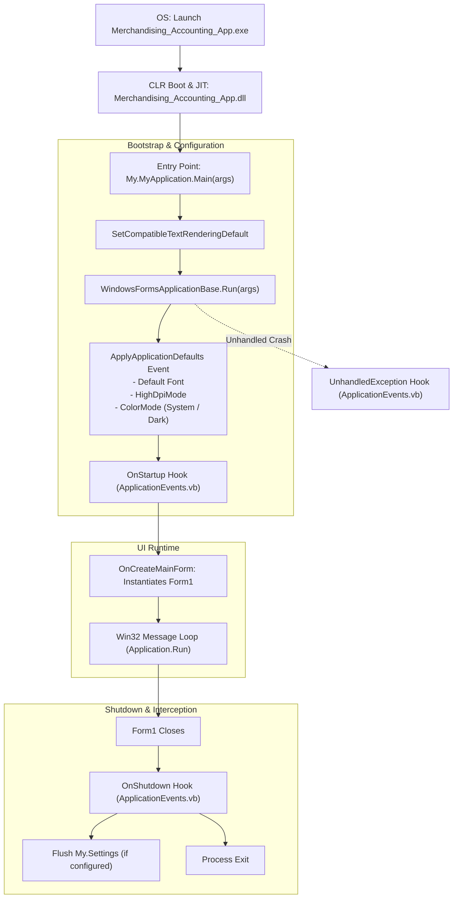

# Initial Architecture Document: Merchandising_Accounting_App

## 1. Project Overview & Environment Baseline

| Attribute | Specification | Evidence / Source |
| :--- | :--- | :--- |
| **Workspace Path** | `C:\Users\maxsa\Documents\Project_Accounting\Merchandising_Accounting_App` | Active workspace directory |
| **IDE Host** | Microsoft Visual Studio 2026 (Internal format `v18`) | `.vs/Merchandising_Accounting_App.slnx/v18/` cache & layout |
| **Solution Model** | Modern XML Solution (`.slnx`) | `Merchandising_Accounting_App.slnx` |
| **Target Framework** | .NET 10.0 (`net10.0-windows`) | `Merchandising_Accounting_App.vbproj` |
| **Language & Platform** | Visual Basic .NET (`MyType: WindowsForms`) | SDK WinForms template |
| **SDK Toolchain** | .NET SDK `10.0.401` / Runtime `10.0.12` / MSBuild `18.9.11` | Build environment |
| **Target Architecture** | Windows x64 (`win-x64`) | `obj/` configuration |

---

## 2. Solution and Project Structure

```
Merchandising_Accounting_App/
├── Merchandising_Accounting_App.slnx        # Modern VS 2026 XML solution definition
├── Merchandising_Accounting_App.vbproj      # .NET 10 SDK-style project file
├── Merchandising_Accounting_App.vbproj.user # Local designer layout configuration
├── ApplicationEvents.vb                     # Application-wide events & configuration hooks
├── Form1.vb                                 # Default main form logic
├── Form1.Designer.vb                        # Form1 component layout & disposal code
├── Form1.resx                               # Embedded resource manifest for Form1
└── My Project/
    ├── Application.myapp                    # Visual Basic Application Framework model descriptor
    └── Application.Designer.vb              # Auto-generated MyApplication singleton code
```

### 2.1 Solution Definition (`.slnx`)
The project utilizes Visual Studio 2026's lightweight XML-based solution format:
```xml
<Solution>
  <Project Path="Merchandising_Accounting_App.vbproj" />
</Solution>
```

### 2.2 Project Configuration (`.vbproj`)
```xml
<Project Sdk="Microsoft.NET.Sdk">
  <PropertyGroup>
    <OutputType>WinExe</OutputType>
    <TargetFramework>net10.0-windows</TargetFramework>
    <StartupObject>Sub Main</StartupObject>
    <UseWindowsForms>true</UseWindowsForms>
    <MyType>WindowsForms</MyType>
  </PropertyGroup>

  <ItemGroup>
    <Import Include="System.Data" />
    <Import Include="System.Drawing" />
    <Import Include="System.Windows.Forms" />
  </ItemGroup>

  <ItemGroup>
    <Compile Update="My Project\Application.Designer.vb">
      <DesignTime>True</DesignTime>
      <AutoGen>True</AutoGen>
      <DependentUpon>Application.myapp</DependentUpon>
    </Compile>
  </ItemGroup>

  <ItemGroup>
    <None Update="My Project\Application.myapp">
      <Generator>MyApplicationCodeGenerator</Generator>
      <LastGenOutput>Application.Designer.vb</LastGenOutput>
    </None>
  </ItemGroup>
</Project>
```

---

## 3. Compiler Environment & Type Safety Profile

The default configuration inherited from `Microsoft.NET.Sdk.VisualBasic.props` and `targets` has notable implications for financial and accounting software:

| Setting | Default Value | Implication for Accounting Software |
| :--- | :--- | :--- |
| `OptionExplicit` | `On` | Prevents undeclared variables. |
| `OptionStrict` | `Off` | **High Risk**: Allows implicit conversions and late binding. Must be toggled to `On` to prevent rounding errors and runtime type mismatches in financial calculations. |
| `OptionInfer` | `On` | Type inference enabled (`Dim amount = 100D`). |
| `OptionCompare` | `Binary` | Case-sensitive ordinal comparisons. |
| `NoWarn` | `41999, 42016...` | Injected by SDK props, suppressing 10 late-binding and type-coercion warnings. |

### Namespace Imports
- **Implicit SDK Imports**: `Microsoft.VisualBasic`, `System`, `System.Collections`, `System.Collections.Generic`, `System.Diagnostics`, `System.Linq`, `System.Xml.Linq`, `System.Threading.Tasks`.
- **Explicit Project Imports**: `System.Data`, `System.Drawing`, `System.Windows.Forms`.

---

## 4. Application Lifecycle & Runtime Mechanics

Visual Basic .NET Windows Forms applications leverage the `Microsoft.VisualBasic.ApplicationServices.WindowsFormsApplicationBase` framework:



### Key Framework Extension Points (`ApplicationEvents.vb`)
- `ApplyApplicationDefaults`: Configures high DPI mode, application font, and modern .NET 10 color mode (`Classic`, `System`, or `Dark`).
- `Startup`: Pre-execution validation (e.g., verifying database connectivity or user authentication before loading forms).
- `Shutdown`: Clean up resources, cache flushing, or audit logging.
- `UnhandledException`: Global crash interceptor to catch unhandled errors and prevent silent termination.

---

## 5. UI Baseline

- **Current Form**: `Form1` (800x450, Font-scaled, empty canvas).
- **Control Count**: 0.
- **Embedded Resources**: `Form1.resx` exists with standard XML schema headers but 0 resource entries.
- **Settings & Resources**: Neither `Settings.settings` nor application-level `Resources.resx` are defined yet.

---

## 6. Recommended Next Steps for Merchandising Accounting

To build out the merchandising accounting application, we recommend adopting a clean, layered architecture:

1. **Compiler Hardening**:
   - Add `<OptionStrict>On</OptionStrict>` and `<TreatWarningsAsErrors>true</TreatWarningsAsErrors>` in `Merchandising_Accounting_App.vbproj`.
   - Ensure all monetary amounts strictly use the `Decimal` type.
2. **Application Shell Setup**:
   - Refactor `Form1` into a main navigation dashboard (e.g., `MainShellForm`).
   - Configure `ApplyApplicationDefaults` in `ApplicationEvents.vb` for modern typography (`Segoe UI Variable Text`) and OS color mode matching.
3. **Domain & Data Architecture**:
   - Define accounting core modules:
     - **General Ledger**: Accounts, Journal Entries (Debits/Credits balance validation).
     - **Merchandising & Inventory**: Product Catalog, SKUs, Stock In/Out, Inventory Costing (FIFO / Weighted Average).
     - **Purchasing & Sales**: Vendor Invoices, Customer Sales Orders, Receivables / Payables.
   - Select data access layer: Entity Framework Core 10 (`Microsoft.EntityFrameworkCore.Sqlite` or SQL Server).
