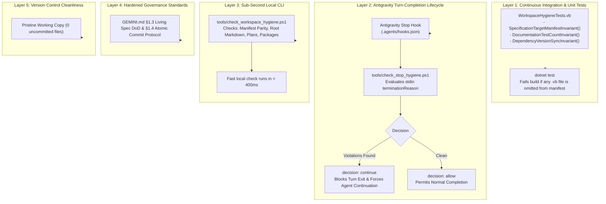
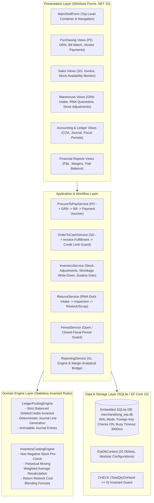

# Master Implementation Plan: Drift Resolution, Antigravity Setup Gaps & Persistent Documentation Governance

- **Target Audience / Reader**: Autonomous AI Agent in a fresh Antigravity `/boost` session.
- **Document Identifier**: `docs/plans/2026-11-21_drift_resolution_and_documentation_governance_plan.md`
- **Target Specification**: [docs/designs/mvp_erp_accounting.md](../designs/mvp_erp_accounting.md)
- **Master Index**: [docs/README.md](../README.md)
- **Source Drift Report**: `2026-11-21_DRIFT_REPORT.md`
- **Execution Mode**: Phased Turnkey Execution (Sequential Phases 1 through 7)
- **Status**: Approved / Ready for Autonomous Execution

---

## Instructions for the Executing Agent (`/boost` Session)

> [!IMPORTANT]
> **READ BEFORE EXECUTING**:
> You are executing this plan in a fresh `/boost` session. You do not need to ask the user for additional clarifications or design decisions.
> All decisions have been resolved and aligned:
> 1. Execute each Phase sequentially from Phase 1 to Phase 7.
> 2. All target files, diff blocks, manifest tables, code snippets, and shell commands are provided verbatim below.
> 3. Standardize test metrics at **217 tests across 15 fixtures** (214 existing + 3 new hygiene tests).
> 4. You MUST execute the 3 structured Git commits at their designated checkpoints as part of your standard definition of done. Do not skip Git commits.
> 5. If delegating to `DeepCoder`, pass the verbatim phase directives provided under each phase.

---

## 1. Goal Description & Forensic Context

This plan reconciles the architectural and documentation divergences identified in `2026-11-21_DRIFT_REPORT.md`, resolves the systemic gaps in Antigravity tooling that allowed documentation to drift, and institutes an automated 5-layer defense-in-depth governance system.

### 1.1 Summary of Divergences Reconciled
1. **Architectural Omission of `InventoryService.vb`**: Integrated into architecture diagrams (§1), component breakdown (§2), and manifest (§366–424).
2. **Target File Manifest Stagnation**: Manifest expanded from 33 items to catalog all 75 active `.vb` source files, modular configuration classes, UI controls, dialogs, ViewModels, PreviewTool, and tests.
3. **Outdated Package Directives**: `Microsoft.EntityFrameworkCore.Sqlite` updated from preview `9.0.2` to official `10.0.0` GA.
4. **Stale Test Metrics**: Baseline updated from 159 to **217 tests** across 15 fixtures.
5. **Positive Features Formalized**: Automated Headless UI Preview Engine (18 scenarios / 36 screenshots), Customer Credit Limits (`CreditLimitExceededException`), GRNI Clearing & PO Short-closing, Decoupled UserControls, MVVM ViewModels, and Financial Dialogs.

### 1.2 Systemic Antigravity Gaps & Root Cause Remediations
* **Gap 1: Reactive-Only `PostToolUse`**: Replaced with an active `Stop` lifecycle hook.
* **Gap 2: Exit Code Suppression**: Removed `if (-not $Hook)` in hygiene scripts so errors propagate cleanly.
* **Gap 3: Missing `Stop` Hook**: Implemented `tools/check_stop_hygiene.ps1` honoring Antigravity's `Stop` contract (`terminationReason: "NO_TOOL_CALL"`), forcing agents back to the loop if gates fail.
* **Gap 4: "Sacred Spec" Inhibitor**: Hardened `GEMINI.md` to define `mvp_erp_accounting.md` as an authoritative **Living** Specification with a mandatory Definition of Done.
* **Gap 5: Missing Automated Git Commit Protocol**: Established `GEMINI.md` Section 1.4 requiring automatic atomic git commits upon satisfying verification gates, ending the "Never-Commit" dirty tree disease.

---

## 2. Multi-Layered Governance Architecture (Defense-in-Depth)



---

## 3. Phased Execution Blueprint (Step-by-Step for Executing Agent)

```
+----------------------------------------------------------------------------------------------------+
|                                      PHASED EXECUTION PIPELINE                                     |
+----------------------------------------------------------------------------------------------------+
| Phase 1: Reconcile Living Specification (docs/designs/mvp_erp_accounting.md)                       |
| Phase 2: Synchronize Master Documentation Index (docs/README.md)                                   |
| Phase 3: Stage, Verify, and Commit Codebase & Documentation Debt (Git Commit 1 & 2)                |
| Phase 4: Implement Automated Manifest & Metric Parity Invariants (WorkspaceHygieneTests.vb)        |
| Phase 5: Implement Antigravity Stop Lifecycle Hook & Fast CLI (check_stop_hygiene.ps1, hooks.json) |
| Phase 6: Update GEMINI.md Governance Standards (Sections 1.3 & 1.4)                                |
| Phase 7: Verification, Plan Archival & Governance Baseline Commit (Git Commit 3)                   |
+----------------------------------------------------------------------------------------------------+
```

---

### Phase 1: Reconcile Living Specification (`docs/designs/mvp_erp_accounting.md`)

The executing agent must apply the following precise edits to `docs/designs/mvp_erp_accounting.md`:

#### 1.1 Architecture Diagram Update (§1, lines 89-120)
Replace the Mermaid diagram in §1 with:


#### 1.2 Component Breakdown Update (§2)
Add `InventoryService` under §2 Application Services:
* **`InventoryService`**:
  * `RecordInventoryAdjustment(productId, quantityDelta, reason, eventDate, user)`: Adjusts on-hand stock forward-only.
  * For negative variances (shrinkage, damage, physical stocktake deficit): Decrements stock, debits `5300 Inventory Shrinkage & Damaged Stock Expense`, credits `1300 Merchandise Inventory` at moving average cost.
  * For positive variances (found stock, physical count surplus): Increments stock, debits `1300 Merchandise Inventory`, credits `4900 Inventory Adjustment Gain` at current moving average cost.

#### 1.3 Schema & Modular Configurations (§3, §3.1–§3.4)
Ensure §3 documents:
* All 25 active DbSets across GL (4), Inventory (4), Procurement (9), Sales (6), Returns (2).
* §3.1 Modular EF Core Configurations: `GeneralLedgerConfigurations.vb`, `InventoryConfigurations.vb`, `ProcurementConfigurations.vb`, `ReturnsConfigurations.vb`, `SalesConfigurations.vb`.
* §3.2 Decoupled UserControls: `DoubleEntryDistributionGridControl`, `FiscalPeriodChipControl`, `BalancedStatusBadgeControl`.
* §3.3 Presentation ViewModels: `LedgerViewModels.vb`, `PurchasingViewModels.vb`, `ReportingViewModels.vb`, `SalesViewModels.vb`, `WarehouseViewModels.vb`.
* §3.4 Financial Protection Dialogs: `FiscalPeriodForm.vb`, `DisburseVendorPaymentDialog.vb`.

#### 1.4 Target File Manifest (§366–424)
Replace the manifest block with this complete, exhaustive 75-file manifest table:

```
+---------------------------------------------------------------------------------------------------------+
|                                  TARGET FILE MANIFEST (PHASED EXECUTION)                                |
+---------------------------------------------------------------------------------------------------------+
| SOLUTION & CONFIGURATION:                                                                               |
| - Merchandising_Accounting_App.slnx                                                    [Modify/Relocate]|
| - Merchandising_Accounting_App/Merchandising_Accounting_App.vbproj                      [Modify]        |
| - Merchandising_Accounting_App/My Project/Application.myapp                            [Modify]        |
| - Merchandising_Accounting_App/ApplicationEvents.vb                                     [Modify]        |
| - Merchandising_Accounting_App/Form1.vb, Form1.Designer.vb, Form1.resx                 [Delete]        |
| - Merchandising_Accounting_App.Tests/Merchandising_Accounting_App.Tests.vbproj         [Create]        |
| - Merchandising_Accounting_App.PreviewTool/Merchandising_Accounting_App.PreviewTool.vbproj[Create]     |
| - Merchandising_Accounting_App.PreviewTool/Program.vb                                   [Create]        |
| - preview_ui.ps1                                                                        [Create]        |
| - tools/check_workspace_hygiene.ps1                                                     [Create]        |
| - tools/check_stop_hygiene.ps1                                                          [Create]        |
| - .agents/hooks.json                                                                    [Create]        |
+---------------------------------------------------------------------------------------------------------+
| DOMAIN LAYER (ENTITIES, ENUMS, ENGINES):                                                                |
| - Merchandising_Accounting_App/Domain/Enums.vb                                         [Create]        |
| - Merchandising_Accounting_App/Domain/Exceptions.vb                                     [Create]        |
| - Merchandising_Accounting_App/Domain/Models/GeneralLedgerEntities.vb                  [Create]        |
| - Merchandising_Accounting_App/Domain/Models/InventoryEntities.vb                      [Create]        |
| - Merchandising_Accounting_App/Domain/Models/ProcurementEntities.vb                    [Create]        |
| - Merchandising_Accounting_App/Domain/Models/SalesEntities.vb                          [Create]        |
| - Merchandising_Accounting_App/Domain/Models/ReturnsEntities.vb                        [Create]        |
| - Merchandising_Accounting_App/Domain/Engines/InventoryCostingEngine.vb                [Create]        |
| - Merchandising_Accounting_App/Domain/Engines/LedgerPostingEngine.vb                   [Create]        |
+---------------------------------------------------------------------------------------------------------+
| PERSISTENCE LAYER (EF CORE 10, CONFIGURATIONS & REPOSITORIES):                                          |
| - Merchandising_Accounting_App/Data/ErpDbContext.vb                                    [Create]        |
| - Merchandising_Accounting_App/Data/DatabaseInitializer.vb                             [Create]        |
| - Merchandising_Accounting_App/Data/Configurations/GeneralLedgerConfigurations.vb      [Create]        |
| - Merchandising_Accounting_App/Data/Configurations/InventoryConfigurations.vb          [Create]        |
| - Merchandising_Accounting_App/Data/Configurations/ProcurementConfigurations.vb        [Create]        |
| - Merchandising_Accounting_App/Data/Configurations/ReturnsConfigurations.vb            [Create]        |
| - Merchandising_Accounting_App/Data/Configurations/SalesConfigurations.vb              [Create]        |
| - Merchandising_Accounting_App/Data/Repositories/AccountRepository.vb                  [Create]        |
| - Merchandising_Accounting_App/Data/Repositories/ProductRepository.vb                  [Create]        |
| - Merchandising_Accounting_App/Data/Repositories/LedgerRepository.vb                   [Create]        |
| - Merchandising_Accounting_App/Data/Repositories/DocumentRepository.vb                 [Create]        |
| - Merchandising_Accounting_App/Data/Repositories/AccountingPeriodRepository.vb         [Create]        |
+---------------------------------------------------------------------------------------------------------+
| APPLICATION SERVICES LAYER:                                                                             |
| - Merchandising_Accounting_App/Services/PeriodService.vb                               [Create]        |
| - Merchandising_Accounting_App/Services/ProcureToPayService.vb                         [Create]        |
| - Merchandising_Accounting_App/Services/OrderToCashService.vb                          [Create]        |
| - Merchandising_Accounting_App/Services/InventoryService.vb                            [Create]        |
| - Merchandising_Accounting_App/Services/ReturnsService.vb                              [Create]        |
| - Merchandising_Accounting_App/Services/ReportingService.vb                            [Create]        |
+---------------------------------------------------------------------------------------------------------+
| PRESENTATION LAYER (WINDOWS FORMS, CONTROLS, VIEWMODELS & DESIGNERS):                                   |
| - Merchandising_Accounting_App/UI/MainShellForm.vb, .Designer.vb, .resx                 [Create]        |
| - Merchandising_Accounting_App/UI/Controls/BalancedStatusBadgeControl.vb, .Des.., .resx[Create]        |
| - Merchandising_Accounting_App/UI/Controls/DoubleEntryDistributionGridControl.vb, ...  [Create]        |
| - Merchandising_Accounting_App/UI/Controls/FiscalPeriodChipControl.vb, .Des.., .resx   [Create]        |
| - Merchandising_Accounting_App/UI/Purchasing/PurchasingDashboardForm.vb, .Des.., .resx  [Create]        |
| - Merchandising_Accounting_App/UI/Purchasing/DisburseVendorPaymentDialog.vb, ...       [Create]        |
| - Merchandising_Accounting_App/UI/Purchasing/PurchasingViewModels.vb                   [Create]        |
| - Merchandising_Accounting_App/UI/Sales/SalesDashboardForm.vb, .Designer.vb, .resx     [Create]        |
| - Merchandising_Accounting_App/UI/Sales/SalesViewModels.vb                              [Create]        |
| - Merchandising_Accounting_App/UI/Warehouse/WarehouseIntakeForm.vb, .Designer.vb, .resx[Create]        |
| - Merchandising_Accounting_App/UI/Warehouse/WarehouseViewModels.vb                      [Create]        |
| - Merchandising_Accounting_App/UI/Accounting/LedgerDashboardForm.vb, .Designer.vb, .resx[Create]       |
| - Merchandising_Accounting_App/UI/Accounting/FiscalPeriodForm.vb, .Designer.vb, .resx   [Create]        |
| - Merchandising_Accounting_App/UI/Accounting/LedgerViewModels.vb                         [Create]        |
| - Merchandising_Accounting_App/UI/Reporting/FinancialReportsForm.vb, .Designer.vb, .resx[Create]       |
| - Merchandising_Accounting_App/UI/Reporting/ReportingViewModels.vb                     [Create]        |
+---------------------------------------------------------------------------------------------------------+
| AUTOMATED TEST SUITE & FIXTURES:                                                                        |
| - Merchandising_Accounting_App.Tests/MSTestSettings.vb                                  [Create]        |
| - Merchandising_Accounting_App.Tests/Infrastructure/TestDatabaseFixture.vb             [Create]        |
| - Merchandising_Accounting_App.Tests/Infrastructure/PersistenceInfrastructureTests.vb   [Create]        |
| - Merchandising_Accounting_App.Tests/Domain/InventoryCostingEngineTests.vb             [Create]        |
| - Merchandising_Accounting_App.Tests/Domain/LedgerPostingEngineTests.vb                [Create]        |
| - Merchandising_Accounting_App.Tests/Services/ProcureToPayServiceTests.vb              [Create]        |
| - Merchandising_Accounting_App.Tests/Services/OrderToCashServiceTests.vb               [Create]        |
| - Merchandising_Accounting_App.Tests/Services/InventoryServiceTests.vb                 [Create]        |
| - Merchandising_Accounting_App.Tests/Services/ReturnsServiceTests.vb                   [Create]        |
| - Merchandising_Accounting_App.Tests/Services/PeriodServiceTests.vb                    [Create]        |
| - Merchandising_Accounting_App.Tests/Services/ReportingServiceTests.vb                 [Create]        |
| - Merchandising_Accounting_App.Tests/Services/SalesDashboardSettlementTests.vb         [Create]        |
| - Merchandising_Accounting_App.Tests/Integration/EndToEndCUJTests.vb                   [Create]        |
| - Merchandising_Accounting_App.Tests/FormInstantiationTests.vb                         [Create]        |
| - Merchandising_Accounting_App.Tests/BrandingAndBrandingStringsTests.vb                 [Create]        |
| - Merchandising_Accounting_App.Tests/DecimalCurrencyFormattingTests.vb                 [Create]        |
| - Merchandising_Accounting_App.Tests/WorkspaceHygieneTests.vb                          [Create]        |
+---------------------------------------------------------------------------------------------------------+
```

#### 1.5 Package & Test Baseline Directives
* §443: Update to `Add NuGet package: Microsoft.EntityFrameworkCore.Sqlite (Version 10.0.0)`.
* Phase 6 Directives: Update baseline to **217 automated tests** across 15 fixtures.

---

### Phase 2: Synchronize Master Documentation Index (`docs/README.md`)

Update line 80 in `docs/README.md`:
```markdown
# Run all unit, integration, and workspace hygiene test fixtures (217 tests)
dotnet test
```

---

### Phase 3: Stage, Verify, and Commit Codebase & Documentation Debt

Execute the following commands in sequence:
```powershell
# 1. Verify tests pass (214 passing tests currently)
dotnet test

# 2. Stage and commit codebase features & preview screenshots
git add Merchandising_Accounting_App/ Merchandising_Accounting_App.Tests/ Merchandising_Accounting_App.PreviewTool/ current_ui_screenshots/ preview_ui.ps1
git commit -m "feat(domain): integrate inventory adjustments, payment disbursements, and UI preview baselines"

# 3. Stage and commit documentation synchronization
git add docs/designs/mvp_erp_accounting.md docs/README.md
git commit -m "docs(spec): reconcile authoritative living specification, manifest, and test counts"
```

---

### Phase 4: Implement Automated Manifest & Metric Parity Invariants (`WorkspaceHygieneTests.vb`)

In `Merchandising_Accounting_App.Tests/WorkspaceHygieneTests.vb`, add the following test methods:

```vb
        <TestMethod>
        Public Sub SpecificationTargetManifestInvariant()
            Dim repoRoot As String = GetRepositoryRoot()
            Dim specPath As String = Path.Combine(repoRoot, "docs", "designs", "mvp_erp_accounting.md")
            Assert.IsTrue(File.Exists(specPath), "mvp_erp_accounting.md must exist.")

            Dim specContent As String = File.ReadAllText(specPath)

            Dim appDir As String = Path.Combine(repoRoot, "Merchandising_Accounting_App")
            Dim testDir As String = Path.Combine(repoRoot, "Merchandising_Accounting_App.Tests")
            Dim previewDir As String = Path.Combine(repoRoot, "Merchandising_Accounting_App.PreviewTool")

            Dim allVbFiles As New List(Of String)()
            For Each dirPath As String In {appDir, testDir, previewDir}
                If Directory.Exists(dirPath) Then
                    For Each filePath As String In Directory.GetFiles(dirPath, "*.vb", SearchOption.AllDirectories)
                        Dim relPath As String = Path.GetRelativePath(repoRoot, filePath).Replace("\"c, "/"c)
                        If relPath.Contains("/bin/") OrElse relPath.Contains("/obj/") OrElse relPath.EndsWith("/Application.Designer.vb", StringComparison.OrdinalIgnoreCase) Then
                            Continue For
                        End If
                        allVbFiles.Add(relPath)
                    Next
                End If
            Next

            Dim unmanifestedFiles As New List(Of String)()
            For Each vbFile As String In allVbFiles
                Dim baseFileName As String = Path.GetFileName(vbFile)
                If Not specContent.Contains(baseFileName, StringComparison.OrdinalIgnoreCase) Then
                    unmanifestedFiles.Add(vbFile)
                End If
            Next

            Assert.AreEqual(0, unmanifestedFiles.Count,
                $"The following source files are missing from the TARGET FILE MANIFEST in docs/designs/mvp_erp_accounting.md:{Environment.NewLine}" &
                $"{String.Join(Environment.NewLine, unmanifestedFiles)}{Environment.NewLine}" &
                "All classes, forms, services, and tests must be cataloged in the authoritative living specification manifest.")
        End Sub

        <TestMethod>
        Public Sub DocumentationTestCountInvariant()
            Dim repoRoot As String = GetRepositoryRoot()
            Dim readmePath As String = Path.Combine(repoRoot, "docs", "README.md")
            Dim specPath As String = Path.Combine(repoRoot, "docs", "designs", "mvp_erp_accounting.md")

            Const ExpectedSuiteCount As Integer = 217

            Dim readmeContent As String = File.ReadAllText(readmePath)
            Assert.IsTrue(readmeContent.Contains($"{ExpectedSuiteCount} tests", StringComparison.OrdinalIgnoreCase),
                $"docs/README.md must cite '{ExpectedSuiteCount} tests'.")

            Dim specContent As String = File.ReadAllText(specPath)
            Assert.IsTrue(specContent.Contains($"{ExpectedSuiteCount} automated tests", StringComparison.OrdinalIgnoreCase) OrElse specContent.Contains($"{ExpectedSuiteCount} tests", StringComparison.OrdinalIgnoreCase),
                $"docs/designs/mvp_erp_accounting.md must cite '{ExpectedSuiteCount} tests'.")
        End Sub

        <TestMethod>
        Public Sub DependencyVersionSyncInvariant()
            Dim repoRoot As String = GetRepositoryRoot()
            Dim vbprojPath As String = Path.Combine(repoRoot, "Merchandising_Accounting_App", "Merchandising_Accounting_App.vbproj")
            Dim specPath As String = Path.Combine(repoRoot, "docs", "designs", "mvp_erp_accounting.md")

            Dim specContent As String = File.ReadAllText(specPath)
            Assert.IsFalse(specContent.Contains("9.0.2 or .NET 10 preview", StringComparison.OrdinalIgnoreCase),
                "docs/designs/mvp_erp_accounting.md must not reference obsolete '9.0.2 or .NET 10 preview' EF Core packages.")
            Assert.IsTrue(specContent.Contains("10.0.0", StringComparison.OrdinalIgnoreCase),
                "docs/designs/mvp_erp_accounting.md must reference official RTM '10.0.0' EF Core package.")
        End Sub
```

Verification Gate:
```powershell
dotnet test
# Expected: Passed! 217 passed, 0 failed.
```

---

### Phase 5: Implement Antigravity `Stop` Hook & Fast Drift CLI

#### 5.1 Create `tools/check_stop_hygiene.ps1`
```powershell
[CmdletBinding()]
param()

$rawInput = [Console]::In.ReadToEnd()
$json = if (-not [string]::IsNullOrWhiteSpace($rawInput)) { $rawInput | ConvertFrom-Json } else { $null }

if ($json -and $json.continuationActive -eq $true) {
    Write-Output '{"decision": "allow"}'
    exit 0
}

if ($json -and $json.terminationReason -ne "NO_TOOL_CALL") {
    Write-Output '{"decision": "allow"}'
    exit 0
}

$toolsDir = Split-Path -Parent $MyInvocation.MyCommand.Path
$hygieneScript = Join-Path $toolsDir "check_workspace_hygiene.ps1"

$output = & powershell -NoProfile -ExecutionPolicy Bypass -File $hygieneScript 2>&1
if ($LASTEXITCODE -ne 0) {
    $cleanReason = ($output -join "; ").Replace('"', '\"')
    Write-Output "{`"decision`": `"continue`", `"reason`": `"[GOVERNANCE GATE FAILURE] Turn completion blocked: $cleanReason. You must fix documentation/manifest drifts before finishing.`"}"
    exit 0
}

# Check for uncommitted work before completing turn
$uncommitted = git status --porcelain
if (-not [string]::IsNullOrWhiteSpace($uncommitted)) {
    Write-Output '{"decision": "continue", "reason": "[GOVERNANCE GATE FAILURE] Turn completion blocked: You have uncommitted changes in your working tree. Per GEMINI.md Section 1.4, stage and commit all verified changes before ending the turn."}'
    exit 0
}

Write-Output '{"decision": "allow"}'
```

#### 5.2 Update `tools/check_workspace_hygiene.ps1`
Add Check 4 (Manifest Completeness), Check 5 (Test Metric Parity), and Check 6 (EF Core Version Parity). Ensure exit code 1 is executed on violations.

#### 5.3 Update `.agents/hooks.json`
```json
{
  "workspace-governance": {
    "Stop": [
      {
        "type": "command",
        "command": "powershell -NoProfile -ExecutionPolicy Bypass -Command \"& { $s = if (Test-Path 'tools/check_stop_hygiene.ps1') { 'tools/check_stop_hygiene.ps1' } else { '../tools/check_stop_hygiene.ps1' }; & $s }\"",
        "timeout": 30
      }
    ],
    "PostToolUse": [
      {
        "matcher": "write_file|edit_file",
        "hooks": [
          {
            "type": "command",
            "command": "powershell -NoProfile -ExecutionPolicy Bypass -Command \"& { $s = if (Test-Path 'tools/check_workspace_hygiene.ps1') { 'tools/check_workspace_hygiene.ps1' } else { '../tools/check_workspace_hygiene.ps1' }; & $s -Hook }\"",
            "timeout": 10
          }
        ]
      }
    ]
  }
}
```

---

### Phase 6: Update `GEMINI.md` Governance Standards

Add Sections 1.3 and 1.4 to `GEMINI.md`:
```markdown
### 1.3 Living Technical Specification & Documentation Definition of Done (DoD)
1. **Living Authoritative Specification**: `docs/designs/mvp_erp_accounting.md` is an Authoritative Living Specification. It is NOT immutable. Whenever codebase architecture evolves, new entities/services/forms/controls/viewmodels are added, or dependencies change, agents MUST synchronize the design specification in the same turn/commit.
2. **Mandatory Documentation Gate**: Every session modifying code must satisfy the following before signaling task completion:
   - [ ] Synchronize `docs/designs/mvp_erp_accounting.md` (Architecture diagram, Component breakdown, Schema, Target File Manifest).
   - [ ] Synchronize `docs/README.md` test metrics and active indices.
   - [ ] Execute `dotnet test` ensuring `WorkspaceHygieneTests` passes all manifest and parity invariants.
   - [ ] Move any completed execution plan in `docs/plans/` to `docs/archive/plans/YYYY-MM-DD_<name>/`.
   - [ ] Ensure `git status` has zero untracked files and working tree is clean.

### 1.4 Mandatory Atomic Git Commit Protocol
1. **Zero Uncommitted Work Invariant**: AI agents must never conclude a turn, end a session, or report a task complete while leaving uncommitted source code, test files, preview images, or documentation in the working tree.
2. **Automated Commit Trigger**: Upon satisfying all verification gates (`dotnet test` 100% pass, `preview_ui.ps1` 100% pass, documentation synced, hygiene check clean), the agent MUST immediately stage all modified and untracked files and create a clean semantic commit (`feat: ...`, `fix: ...`, `docs: ...`, `refactor: ...`).
3. **Local Commit Safety**: Commits are created locally. Remote pushes (`git push`) remain strictly gated by explicit user instruction.
```

---

### Phase 7: Verification, Plan Archival & Governance Baseline Commit

Execute:
```powershell
# 1. Full Test Suite Verification (all 217 tests pass)
dotnet test

# 2. Fast Hygiene Verification (exit code 0)
powershell -File .\tools\check_workspace_hygiene.ps1

# 3. Simulate Stop Hook
'{"executionNum":1,"terminationReason":"NO_TOOL_CALL","fullyIdle":true,"continuationActive":false}' | powershell -File .\tools\check_stop_hygiene.ps1
# Expected output: {"decision": "allow"}

# 4. Archive plan per GEMINI.md Rule 1.2
New-Item -ItemType Directory -Force -Path "docs/archive/plans/2026-11-21_drift_resolution"
Move-Item -Path "docs/plans/2026-11-21_drift_resolution_and_documentation_governance_plan.md" -Destination "docs/archive/plans/2026-11-21_drift_resolution/"

# 5. Git Commit 3
git add Merchandising_Accounting_App.Tests/WorkspaceHygieneTests.vb tools/ .agents/ GEMINI.md docs/archive/
git commit -m "feat(governance): implement automated manifest sync invariants, fast hygiene CLI, and Antigravity Stop hook"
```

---

## 4. Final Definition of Done (Prerequisites for Terminating Session)

The executing `/boost` session may only report completion when all 5 conditions are satisfied:
1. `dotnet test` returns **217 passed, 0 failed, 0 warnings**.
2. `powershell -File .\preview_ui.ps1 --all --mode both` renders **36/36 screenshots successfully**.
3. `powershell -File .\tools\check_workspace_hygiene.ps1` exits with **code 0**.
4. The plan has been moved to `docs/archive/plans/2026-11-21_drift_resolution/`.
5. `git status` reports:
   ```
   On branch master
   nothing to commit, working tree clean
   ```
