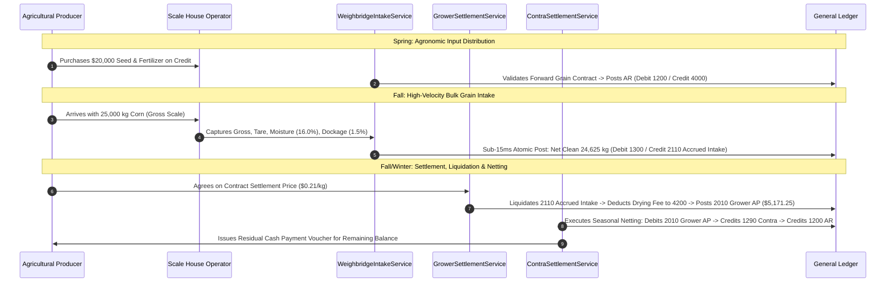

# Agricultural Merchandising ERP Accounting Application

* **Author:** Max Sainz
* **Status:** Draft
* **Date:** 2026-11-21

--------------------------------------------------------------------------------

## Overview

Small-to-mid scale agricultural merchandising businesses—specifically country grain elevators and agricultural input retailers—operate a dual-lifecycle commercial business model across the farming calendar. In the spring and planting season, merchants distribute packaged agronomic inputs (certified seed sacks, bulk and tote fertilizers, crop protection chemicals) to local growers, often extending substantial seasonal trade credit. In the autumn harvest season, the same merchants switch to high-velocity bulk grain aggregation, operating weighbridge truck scales, probe sampling, dockage and moisture grading, silo aeration, and commingled storage for dry bulk crops (Corn, Soybeans, Wheat, Rice). At harvest end, merchants settle grain purchases and net farmers' outstanding spring input debts against their crop delivery proceeds.

Operating these dual lifecycles on disconnected spreadsheets or generic accounting software introduces severe financial and operational failure points: phantom grain quantities, uncontrolled moisture shrink, unhedged market price swings on unsettled scale tickets, delayed cross-subledger farmer netting, and database write lockups during the peak receiving rush.

This design document establishes the architecture for an integrated desktop ERP accounting application for agricultural merchandising. Built as a single-workstation .NET 10 / Visual Basic .NET / SQLite Windows Forms system, it extends the foundational double-entry General Ledger and perpetual inventory architecture of the Merchandising ERP while introducing specialized domain engines for weighbridge scale ticketing, two-stage provisional grain intake, automated dockage deduction, drying service revenue recognition, commingled silo lot tracking, silo clean-out moisture shrinkage write-downs, dual-tier contract-backed credit controls, and tripartite AR/AP seasonal contra-clearing.

All physical stock quantities remain strictly anchored to atomic integer kilograms (Integer kg), preserving the non-negative stock invariant (`CHECK (TotalQtyOnHand >= 0)`) without floating-point calculation errors.

--------------------------------------------------------------------------------

## The Problem

Generic merchandising and retail ERP systems assume discrete packaged items, instantaneous invoice-to-receipt matching, and clear separation between customers and suppliers. Applying standard packaged-goods ERP logic to country grain aggregation and farm input retail causes four systemic points of failure:

1. **Intake Velocity vs. Pricing Exposure Conflict**: During peak harvest, 150 to 250 semi-trucks arrive daily at the elevator. Trucks must be weighed, graded, dumped, and tared in under three minutes to prevent highway backups. However, grain pricing is frequently deferred (Delayed Price / Basis contracts) or unsettled at the moment of intake. Traditional ERPs either block receiving until a purchase price is established (freezing the elevator) or ingest unvalued stock (distorting moving average unit costs and rendering COGS undefined).
2. **Physical Commingling vs. Lot Traceability Breakdown**: Once dumped into a receiving pit, bulk grain from dozens of producers is commingled in large silos by quality grade. Standard lot-tracking systems that mandate tracking specific vendor lots throughout inventory movements force artificial lot splitting or crash outbound shipments. Conversely, eliminating intake tracking entirely destroys food safety recall compliance when grain contaminants (e.g., aflatoxin, sour odor) are later discovered.
3. **Moisture Evaporation and Invisible Storage Shrinkage**: Grain is an active biological commodity. Aeration and ambient storage cause natural moisture loss and dust aspiration. If an elevator receives 100,000 kg of corn at 15.0% moisture and aerates it down to 13.5%, hundreds of kilograms of water vanish. Without formal clean-out and shrinkage reconciliation, book inventory overstates physical stock, eventually causing outbound sales to fail with hard-stop stock exceptions.
4. **Seasonal Producer Counterparty Duality & Credit Default**: Local growers are simultaneously customers in the spring (purchasing seed and fertilizer on credit) and vendors in the fall (delivering grain). When standard ERPs isolate AR and AP into rigid silos, bookkeepers must issue manual checks while receivables age past 180 days. Furthermore, granting unsecured trade credit without validating the grower's committed forward harvest volume exposes the business to catastrophic bad debt if the grower defaults or sells elsewhere.

--------------------------------------------------------------------------------

## Goals

* **Sub-15ms Weighbridge Scale Intake**: Capture gross weight, tare weight, moisture percentage, and dockage percentage in a single-screen rapid UI, computing dockage kilograms via banker's half-up rounding (`MidpointRounding.AwayFromZero`) and posting intake records to the database within 15 milliseconds.
* **Two-Stage Provisional Grain Procurement Accounting**: Value inbound grain immediately at the elevator's active posted cash benchmark price (Debit `1300 Merchandise Inventory` / Credit `2110 Accrued Grower Intake`) to maintain real-time perpetual inventory valuation and permit instant outbound sales dispatch.
* **Controlled Liquidation & Variance Segregation**: Liquidate scale ticket accruals via a formal `GrowerSettlementSheet`, routing commodity contract price differences to `5110 Grain Basis & Delayed Price Variance` and recording moisture conditioning fees into `4200 Agricultural Services & Drying Revenue`.
* **Mandatory Delayed Price Expiration**: Enforce a strict 90-day maximum pricing window on unpriced Delayed Price (DP) scale tickets, accruing monthly carrying fees to `4200` and automatically pricing unexercised tickets at the 90-day spot cash close.
* **Commingled Silo Storage with Formal Clean-Out Reconciliation**: Commingle grain by product, grade, and harvest year in `SiloBinLots` (`CHECK (CurrentQtyKg >= 0)`), while providing an append-only `SiloCleanOut` document to write off natural moisture evaporation deficits to `5350 Agricultural Commodity Moisture Shrinkage`.
* **Automated Two-Tier Recall Traceability**: Preserve granular origin data (`GrowerId`, `FarmFieldId`, `TruckPlate`, probe sample jar reference) on intake scale tickets, enabling retrospective temporal traceability for commingled silos without attaching vendor identity to storage lots.
* **Tripartite Seasonal AR/AP Contra-Clearing**: Automate net settlements between spring input invoices (`1200 AR`) and fall grain payouts (`2010 Grower AP`) through `1290 Farmer Contra-Clearing Account`, producing zero-cash balancing entries and issuing net cash payment vouchers.
* **Contract-Linked Credit Protection for Spring Inputs**: Enforce dual-tier credit limits (`UnsecuredCreditLimit` and `CropSecuredCreditLimit`), blocking spring agronomic sales that exceed unsecured limits unless backed by an active, unfulfilled `GrainPurchaseContract` of equivalent forward value.
* **Strict Integer Metric Invariant**: Enforce integer kilograms (`Integer` kg) as the atomic base unit across all bulk grains and packaged inputs, preventing floating-point rounding errors and preserving database constraints.

--------------------------------------------------------------------------------

## Non-Goals

* **Automated Futures & Derivative Hedging**: No direct electronic order execution with commodity exchanges (e.g., CBOT/CME) or mark-to-market accounting for financial derivative positions.
* **Multi-Elevator Network Logistics**: No multi-facility transfer routing, centralized rail fleet scheduling, or in-transit inter-elevator balancing. The MVP targets a single country elevator facility.
* **Biological Asset Farming (IAS 41)**: No crop growth modeling, field planting logs, machinery depreciation tracking, or livestock accounting.
* **Industrial Milling or Food Processing (BOM/WIP)**: No conversion of raw grain into flour, animal feed rations, or ethanol.
* **Automated Scale Hardware Polling via Low-Level Drivers**: The application polls scale indicators via standard RS-232 / COM / TCP ASCII data streams into an in-memory buffer; no vendor-proprietary PLC or SCADA industrial protocols are implemented.
* **Multi-Currency & Foreign Exchange**: All transactions and commodity prices are recorded in the single domestic base currency.

--------------------------------------------------------------------------------

## Open Questions & Formal Resolutions

* **Open Question 1: How are sub-kilogram fractions from dockage percentage calculations handled without violating the integer stock invariant?**
  * *Resolution:* Scale indicator hardware measures in 5 kg or 10 kg increments. Dockage kilograms are calculated as $\text{GrossInboundKg} \times \frac{\text{DockagePct}}{100}$ and rounded to the nearest integer kilogram using `MidpointRounding.AwayFromZero`. Net clean weight is $\text{GrossInboundKg} - \text{DockageKg}$. Invariant validation enforces $\text{DockageKg} + \text{NetCleanKg} \equiv \text{GrossInboundKg}$, ensuring zero loss of measured mass.
* **Open Question 2: How does the system handle grain pricing that occurs across accounting periods?**
  * *Resolution:* Scale tickets post at the delivery date's posted cash benchmark price against `2110 Accrued Grower Intake` in the open period. When the `GrowerSettlementSheet` is posted in a subsequent open period, `2110` is cleared at the provisional value, the true liability is recognized in `2010 Grower AP`, and the difference posts to `5110 Grain Basis & Delayed Price Variance` in the current open period. Past closed periods are never altered.
* **Open Question 3: How does the business display bushels to growers while maintaining integer kilograms in the database?**
  * *Resolution:* Database columns, ledger entries, and inventory movements operate strictly in integer kilograms. The Windows Forms UI dynamically displays virtual bushel equivalents on screen using standard test weight conversion constants (e.g., 25.4012 kg/bu for Corn, 27.2155 kg/bu for Soybeans/Wheat) as read-only calculated presentation fields.

--------------------------------------------------------------------------------

## Critical User Journeys (CUJs)

### CUJ 1: High-Velocity Inbound Grain Receiving & Scale Ticket Intake
* **Given**: A grower arrives at the elevator scale deck with a semi-truck loaded with yellow corn. The active posted cash benchmark price is $0.20/kg.
* **When**: The scale clerk selects the truck plate / RFID, capturing Gross Weight (38,200 kg). The probe operator inputs 15.5% moisture and 1.8% foreign matter. The truck dumps into Pit A (routed to Silo 04) and returns to the scale deck to capture Tare Weight (14,200 kg). The clerk commits the ticket.
* **Then**: 
  - $\text{Gross Inbound Kg} = 38,200 - 14,200 = 24,000\text{ kg}$.
  - $\text{Dockage Kg} = \text{Round}(24,000 \times 0.018) = 432\text{ kg}$.
  - $\text{Net Clean Kg} = 24,000 - 432 = 23,568\text{ kg}$.
  - `WeighbridgeScaleTicket` is committed in $<15\text{ ms}$ with status `PendingSettlement`.
  - Database atomically updates `Products.TotalQtyOnHand` ($+23,568\text{ kg}$) and `SiloBinLots.CurrentQtyKg` ($+23,568\text{ kg}$).
  - A General Ledger journal entry posts: Debit `1300 Merchandise Inventory` $4,713.60 ($23,568\text{ kg} \times \$0.20$), Credit `2110 Accrued Grower Intake` $4,713.60.
  - Scale ticket prints; clean corn is instantly available for outbound dispatch.

### CUJ 2: Fall Grower Settlement Sheet with Drying Revenue & Contra-Clearing
* **Given**: Grower John Doe delivered 50,000 net clean kg of corn across two scale tickets accrued at $0.20/kg ($10,000.00 in `2110 Accrued Grower Intake`). The agreed settlement contract price is $0.21/kg ($10,500.00 gross value). Moisture conditioning fees total $350.00. The grower has an unpaid spring fertilizer invoice of $4,200.00 in `1200 AR`.
* **When**: The grain accountant generates and posts a `GrowerSettlementSheet` and applies seasonal contra-clearing.
* **Then**:
  - The settlement sheet liquidates provisional intake: Debit `2110 Accrued Grower Intake` $10,000.00.
  - Price variance is recognized: Debit `5110 Grain Basis & Delayed Price Variance` $500.00.
  - Drying revenue is earned: Credit `4200 Agricultural Services & Drying Revenue` $350.00.
  - Gross grower payable is recognized: Credit `2010 Grower AP` $10,150.00.
  - A `FarmerContraSettlement` executes: Debit `2010 Grower AP` $4,200.00, Credit `1290 Farmer Contra-Clearing` $4,200.00; Debit `1290 Farmer Contra-Clearing` $4,200.00, Credit `1200 AR` $4,200.00 (fully settling the spring invoice).
  - A Payment Voucher disburses the remaining cash: Debit `2010 Grower AP` $5,950.00, Credit `1020 Operating Bank Account` $5,950.00.

### CUJ 3: Spring Agronomic Input Sale with Contract-Linked Credit Guard
* **Given**: Grower Jane Smith has an `UnsecuredCreditLimit` of $5,000.00 and an existing AR balance of $1,200.00. She orders $28,000.00 of bulk fertilizer and seed bags. Jane has an active `GrainPurchaseContract` committing 200,000 kg of fall corn at a minimum contract base price of $0.19/kg ($38,000.00 forward value).
* **When**: The sales representative attempts to post the sales invoice for $28,000.00.
* **Then**:
  - The order causes total AR ($29,200.00) to exceed the unsecured limit ($5,000.00).
  - `OrderToCashService` inspects active grower contracts and verifies that forward harvest value ($38,000.00) $\ge$ proposed balance ($29,200.00).
  - The system validates that the customer record has active crop lien metadata (`HasCropLienFiling = True`).
  - The sales invoice posts successfully: Debit `1200 AR` $28,000.00, Credit `4000 Sales Revenue` $28,000.00; inventory and COGS update based on integer packaging multipliers.

### CUJ 4: Silo Clean-Out & Moisture Shrinkage Reconciliation
* **Given**: Silo 04 had 500,000 kg of corn deposited during harvest at moving average unit cost $0.20/kg. Over 4 months, outbound dispatches totaled 492,000 kg. Book inventory in `SiloBinLots` shows 8,000 kg remaining. Aeration blowers are shut down and the bin sweep is completed, confirming the silo is physically empty.
* **When**: The elevator superintendent executes a `SiloCleanOut` document recording actual remaining physical quantity as 0 kg.
* **Then**:
  - Kilogram shrinkage loss is computed: $8,000\text{ kg} - 0\text{ kg} = 8,000\text{ kg}$ moisture/aeration loss.
  - Shrinkage expense amount is computed: $8,000\text{ kg} \times \$0.20/\text{kg} = \$1,600.00$.
  - An append-only journal entry posts: Debit `5350 Agricultural Commodity Moisture Shrinkage` $1,600.00, Credit `1300 Merchandise Inventory` $1,600.00.
  - `SiloBinLots.CurrentQtyKg` and `Products.TotalQtyOnHand` for Silo 04 atomically decrement by 8,000 kg to exactly 0 kg.
  - The silo status resets to empty and clean, ready for the next harvest without violating `CHECK (CurrentQtyKg >= 0)`.

--------------------------------------------------------------------------------

## Technical Plan (Architecture)

### 1. System Architecture Overview

The application follows the strict four-layer architecture established in `GEMINI.md`: Presentation, Application Services, Pure Domain Engines, and Persistence. It targets .NET 10.0 Windows Forms on Windows x64 with an embedded SQLite database (`Microsoft.EntityFrameworkCore.Sqlite`) in WAL mode.

```mermaid
flowchart TD
    subgraph UI ["Presentation Layer (Windows Forms .NET 10)"]
        Shell["MainShellForm (Top-Level Container & Navigation)"]
        ScaleView["WeighbridgeIntakeControl (Touch & Go Scale Screen)"]
        SettleView["GrowerSettlementControl (Liquidation & Drying Deductions)"]
        ContraView["FarmerContraSettlementControl (Seasonal Netting)"]
        SiloView["SiloInventoryControl (Bins, Grades & Clean-Outs)"]
        ExposureView["UnpricedGrainExposureControl (DP Risk Inquiry)"]
        InputView["Agronomic Sales & Credit Views (Seed, Chem, Fertilizer)"]
        HardwareThread["ScaleIndicatorReader (Async In-Memory Ring Buffer)"]
    end

    subgraph Service ["Application & Workflow Layer"]
        ScaleSvc["WeighbridgeIntakeService (Sub-15ms Atomic Intake)"]
        SettleSvc["GrowerSettlementService (Liquidation & Fee Posting)"]
        ContraSvc["ContraSettlementService (Cross-Subledger Netting)"]
        StorageSvc["GrainStorageService (Transfers & Silo Clean-Outs)"]
        ExposureSvc["GrainExposureReportingService (Mark-to-Market DP Exposure)"]
        O2CSvc["OrderToCashService (Contract-Backed Credit Guards)"]
        P2PSvc["ProcureToPayService (Commercial Inputs 3-Way Match)"]
        PeriodSvc["PeriodService (Locked Period Enforcement)"]
    end

    subgraph Domain ["Pure Domain & Calculation Engines"]
        GradingEngine["GrainGradingEngine (Half-Up Dockage & Moisture Deductions)"]
        LedgerEngine["LedgerPostingEngine (Append-Only Balanced Entry Generator)"]
        CostEngine["InventoryCostingEngine (Perpetual Moving Weighted Average)"]
        Entities["Domain Entities (ScaleTickets, SiloLots, Settlements, Contracts)"]
    end

    subgraph Persistence ["Persistence Layer (EF Core 10 / SQLite)"]
        DbContext["ErpDbContext (Primary Read/Write Connection, busy_timeout=5000)"]
        ReadOnlyContext["ErpReadOnlyDbContext (AsNoTracking Analytical Queries)"]
        SqliteStore[("SQLite Embedded Database (merchandising_erp.db)")]
    end

    ScaleView --> HardwareThread
    ScaleView --> ScaleSvc
    SettleView --> SettleSvc
    ContraView --> ContraSvc
    SiloView --> StorageSvc
    ExposureView --> ExposureSvc
    InputView --> O2CSvc

    ScaleSvc --> GradingEngine
    ScaleSvc --> LedgerEngine
    ScaleSvc --> CostEngine
    ScaleSvc --> DbContext

    SettleSvc --> LedgerEngine
    SettleSvc --> DbContext

    ContraSvc --> LedgerEngine
    ContraSvc --> DbContext

    StorageSvc --> LedgerEngine
    StorageSvc --> DbContext

    O2CSvc --> DbContext
    ExposureSvc --> ReadOnlyContext

    DbContext --> SqliteStore
    ReadOnlyContext --> SqliteStore
```



---

### 2. Dual-Lifecycle Operational Workflow



---

### 3. Component Breakdown & Responsibilities

#### 3.1 Presentation Layer
* **`WeighbridgeIntakeControl`**: Single-screen "Touch-and-Go" control designed for rapid scale house operations. Displays Gross Weight, Tare Weight, Net Inbound Kg, Moisture %, Foreign Matter %, Dockage Kg, and Net Clean Kg. Integrates background scale readings, displays calculated virtual bushel equivalents, and provides a single keyboard shortcut (`F10` or Enter) to commit.
* **`GrowerSettlementControl`**: Multi-ticket liquidation workspace. Loads unsettled scale tickets for a selected grower, applies contracted unit price, computes moisture drying fee deductions, and renders previewed debit/credit distribution lines.
* **`FarmerContraSettlementControl`**: Two-pane reconciliation screen. The left pane displays open spring input invoices (`1200 AR`); the right pane displays un-settled harvest grain proceeds (`2010 Grower AP`). Generates atomic contra-clearing documents that balance to $0.00 across subledgers.
* **`SiloInventoryControl`**: Visual bin-board showing active capacity, commodity grade, current on-hand weight (kg), and average unit cost for each physical silo. Provides action triggers for Silo Transfers and `SiloCleanOut` reconciliation.
* **`UnpricedGrainExposureControl`**: Managerial dashboard tracking unsettled Delayed Price (DP) scale tickets in Account `2110 Accrued Grower Intake`, displaying delivery dates, days unpriced, contract expiration countdowns, and mark-to-market margin exposure.
* **`ScaleIndicatorReader`**: Low-overhead serial communication worker running on a dedicated background thread. Polls the digital scale indicator via RS-232 / COM port or TCP socket continuously, storing the latest stable gross weight in a thread-safe atomic ring buffer without blocking UI or database threads.

#### 3.2 Application Services
* **`WeighbridgeIntakeService`**: Orchestrates the sub-15ms atomic intake transaction:
  1. Computes dockage and net clean weight via `GrainGradingEngine`.
  2. Inserts `WeighbridgeScaleTicket`.
  3. Increments `Products.TotalQtyOnHand` via atomic conditional SQL.
  4. Increments `SiloBinLots.CurrentQtyKg` and blends moving weighted average cost.
  5. Inserts `InventoryTransaction` record (`TransactionType = 'GrainIntake'`).
  6. Generates and inserts balanced `JournalEntry` (Debit `1300` / Credit `2110`).
* **`GrowerSettlementService`**: Handles financial liquidation of unpriced or basis tickets:
  1. Reconciles liquidated scale tickets against contract price.
  2. Liquidates `2110 Accrued Grower Intake` at provisional delivery cost.
  3. Routes pricing differences to `5110 Grain Basis & Delayed Price Variance`.
  4. Deducts drying and storage charges, crediting `4200 Agricultural Services & Drying Revenue`.
  5. Recognizes gross liability in `2010 Grower Accounts Payable`.
* **`ContraSettlementService`**: Manages the seasonal offset between grower payables and input receivables:
  1. Verifies that grower AP balance $\ge$ selected AR invoice balance.
  2. Generates `FarmerContraSettlement` document.
  3. Posts balancing double-entry journal lines:
     - Debit `2010 Grower AP` $[ContraAmount]$
     - Credit `1290 Farmer Contra-Clearing` $[ContraAmount]$
     - Debit `1290 Farmer Contra-Clearing` $[ContraAmount]$
     - Credit `1200 Accounts Receivable` $[ContraAmount]$
  4. Closes the AR sales invoices and updates the customer AR subledger.
* **`GrainStorageService`**: Manages physical silo storage:
  1. Logs intra-elevator silo transfers (moving grain from intake wet bins through dryer to dry storage silos).
  2. Executes `SiloCleanOut` write-downs when a silo is emptied, debiting `5350 Agricultural Commodity Moisture Shrinkage` and resetting lot inventory to 0 kg.
* **`OrderToCashService` (Extended)**:
  - Enforces dual-tier credit check during sales invoice creation:
    $$\text{Effective AR} = \text{Current AR Balance} + \text{Pending Invoice Total}$$
    $$\text{If } \text{Effective AR} > \text{UnsecuredCreditLimit}:$$
    $$\text{Require } \sum(\text{Active Contract Kg} \times \text{Base Price}) \ge \text{Effective AR}$$
  - Verifies presence of statutory crop lien filing (`HasCropLienFiling = True`) before allowing sales exceeding unsecured thresholds.

#### 3.3 Pure Domain Engines
* **`GrainGradingEngine`**: Stateless mathematical calculation engine enforcing standard agronomic formulas and rounding invariants:
  $$\text{GrossInboundKg} = \text{GrossWeightKg} - \text{TareWeightKg}$$
  $$\text{RawDockageKg} = \text{GrossInboundKg} \times \frac{\text{ForeignMatterPct}}{100}$$
  $$\text{DockageKg} = \text{CInt}\left(\text{Math.Round}(\text{RawDockageKg}, \text{MidpointRounding.AwayFromZero})\right)$$
  $$\text{NetCleanKg} = \text{GrossInboundKg} - \text{DockageKg}$$
  $$\text{MoistureDeductionAmount} = \text{NetCleanKg} \times \text{MoistureRateTable.Lookup}(\text{CommodityId}, \text{MoisturePct})$$
* **`LedgerPostingEngine` (Extended)**:
  - Added posting rules for `WeighbridgeScaleTicket` (Rule 11: Grain Intake Accrual).
  - Added posting rules for `GrowerSettlementSheet` (Rule 12: Grain Settlement & Drying Revenue).
  - Added posting rules for `FarmerContraSettlement` (Rule 13: AR/AP Contra-Clearing).
  - Added posting rules for `SiloCleanOut` (Rule 14: Silo Aeration Moisture Shrinkage).

---

### 4. Database Relational Schema DDL

The database schema builds upon the 25 existing core tables in `mvp_erp_accounting.md`, adding 6 specialized tables and altering 2 existing entities.

```sql
-- ============================================================================
-- 1. Weighbridge Scale Tickets (High-Velocity Inbound Grain Intake)
-- ============================================================================
CREATE TABLE WeighbridgeScaleTickets (
    TicketId INTEGER PRIMARY KEY AUTOINCREMENT,
    TicketNumber VARCHAR(35) NOT NULL UNIQUE,
    GrowerId INTEGER NOT NULL,
    FarmFieldId INTEGER NULL,
    TruckPlate VARCHAR(20) NOT NULL,
    GrossWeightKg INTEGER NOT NULL,
    TareWeightKg INTEGER NOT NULL,
    GrossInboundKg INTEGER NOT NULL,
    MoisturePct DECIMAL(5,2) NOT NULL,
    ForeignMatterPct DECIMAL(5,2) NOT NULL,
    DockageKg INTEGER NOT NULL,
    NetCleanKg INTEGER NOT NULL,
    CommodityProductId INTEGER NOT NULL,
    TargetSiloBinLotId INTEGER NOT NULL,
    PricingType VARCHAR(25) NOT NULL, -- 'SpotCash', 'ContractFixed', 'DelayedPrice'
    AssociatedContractId INTEGER NULL,
    ProvisionalUnitPrice DECIMAL(18,4) NOT NULL,
    ProvisionalTotalAmount DECIMAL(18,4) NOT NULL,
    Status VARCHAR(25) NOT NULL, -- 'PendingSettlement', 'Settled', 'Voided'
    ReceiptDate DATETIME NOT NULL,
    PostingDate DATETIME NOT NULL,
    DelayedPriceExpiryDate DATETIME NULL,
    CreatedBy VARCHAR(50) NOT NULL,
    CreatedAt DATETIME NOT NULL DEFAULT CURRENT_TIMESTAMP,
    CONSTRAINT CK_ScaleTicket_Weights CHECK (GrossWeightKg >= TareWeightKg),
    CONSTRAINT CK_ScaleTicket_GrossInbound CHECK (GrossInboundKg = GrossWeightKg - TareWeightKg),
    CONSTRAINT CK_ScaleTicket_NetClean CHECK (NetCleanKg = GrossInboundKg - DockageKg),
    CONSTRAINT CK_ScaleTicket_NonNegativeNet CHECK (NetCleanKg >= 0),
    FOREIGN KEY (GrowerId) REFERENCES Vendors(VendorId),
    FOREIGN KEY (CommodityProductId) REFERENCES Products(ProductId),
    FOREIGN KEY (TargetSiloBinLotId) REFERENCES SiloBinLots(LotId),
    FOREIGN KEY (AssociatedContractId) REFERENCES GrainPurchaseContracts(ContractId)
);
CREATE INDEX IX_ScaleTickets_GrowerStatus ON WeighbridgeScaleTickets(GrowerId, Status);
CREATE INDEX IX_ScaleTickets_PostingDate ON WeighbridgeScaleTickets(PostingDate);

-- ============================================================================
-- 2. Silo & Bin Lots (Commingled Bulk Grain Storage by Grade)
-- ============================================================================
CREATE TABLE SiloBinLots (
    LotId INTEGER PRIMARY KEY AUTOINCREMENT,
    SiloIdentifier VARCHAR(30) NOT NULL,
    CommodityProductId INTEGER NOT NULL,
    GradeCode VARCHAR(20) NOT NULL,
    HarvestYear INTEGER NOT NULL,
    CapacityKg INTEGER NOT NULL,
    CurrentQtyKg INTEGER NOT NULL DEFAULT 0,
    CurrentMovingAvgCost DECIMAL(18,4) NOT NULL DEFAULT 0.0000,
    IsIdentityPreserved BIT NOT NULL DEFAULT 0,
    OriginGrowerId INTEGER NULL,
    IsActive BIT NOT NULL DEFAULT 1,
    LastCleanOutDate DATETIME NULL,
    CONSTRAINT CK_SiloBinLots_NonNegative CHECK (CurrentQtyKg >= 0),
    CONSTRAINT CK_SiloBinLots_Capacity CHECK (CurrentQtyKg <= CapacityKg),
    FOREIGN KEY (CommodityProductId) REFERENCES Products(ProductId),
    FOREIGN KEY (OriginGrowerId) REFERENCES Vendors(VendorId)
);
CREATE UNIQUE INDEX UX_SiloBinLots_Identifier ON SiloBinLots(SiloIdentifier, CommodityProductId, HarvestYear);

-- ============================================================================
-- 3. Grain Purchase Contracts (Forward Delivery & Seasonal Credit Security)
-- ============================================================================
CREATE TABLE GrainPurchaseContracts (
    ContractId INTEGER PRIMARY KEY AUTOINCREMENT,
    ContractNumber VARCHAR(35) NOT NULL UNIQUE,
    GrowerId INTEGER NOT NULL,
    CommodityProductId INTEGER NOT NULL,
    GradeCode VARCHAR(20) NOT NULL,
    HarvestYear INTEGER NOT NULL,
    ContractType VARCHAR(25) NOT NULL, -- 'CashForward', 'BasisFixed', 'DelayedPrice'
    ContractedQtyKg INTEGER NOT NULL,
    DeliveredQtyKg INTEGER NOT NULL DEFAULT 0,
    BasePricePerKg DECIMAL(18,4) NOT NULL,
    DeliveryStartDate DATETIME NOT NULL,
    DeliveryEndDate DATETIME NOT NULL,
    Status VARCHAR(25) NOT NULL, -- 'Active', 'Fulfilled', 'Cancelled'
    CreatedAt DATETIME NOT NULL DEFAULT CURRENT_TIMESTAMP,
    CONSTRAINT CK_Contract_Quantities CHECK (ContractedQtyKg > 0 AND DeliveredQtyKg >= 0),
    FOREIGN KEY (GrowerId) REFERENCES Vendors(VendorId),
    FOREIGN KEY (CommodityProductId) REFERENCES Products(ProductId)
);

-- ============================================================================
-- 4. Grower Settlement Sheets (Liquidation & Purchase Settlement)
-- ============================================================================
CREATE TABLE GrowerSettlementSheets (
    SettlementId INTEGER PRIMARY KEY AUTOINCREMENT,
    SettlementNumber VARCHAR(35) NOT NULL UNIQUE,
    GrowerId INTEGER NOT NULL,
    SettlementDate DATETIME NOT NULL,
    PostingDate DATETIME NOT NULL,
    TotalNetCleanKg INTEGER NOT NULL,
    GrossCommodityValue DECIMAL(18,4) NOT NULL,
    ProvisionalIntakeValuation DECIMAL(18,4) NOT NULL,
    PriceVarianceAmount DECIMAL(18,4) NOT NULL DEFAULT 0.0000,
    DryingChargesTotal DECIMAL(18,4) NOT NULL DEFAULT 0.0000,
    StorageFeesTotal DECIMAL(18,4) NOT NULL DEFAULT 0.0000,
    NetPayableAmount DECIMAL(18,4) NOT NULL,
    ContraClearedAmount DECIMAL(18,4) NOT NULL DEFAULT 0.0000,
    CashDisbursedAmount DECIMAL(18,4) NOT NULL DEFAULT 0.0000,
    Status VARCHAR(25) NOT NULL, -- 'Draft', 'Posted', 'Settled'
    CreatedBy VARCHAR(50) NOT NULL,
    CreatedAt DATETIME NOT NULL DEFAULT CURRENT_TIMESTAMP,
    CONSTRAINT CK_Settlement_PayableMath CHECK (NetPayableAmount = GrossCommodityValue - DryingChargesTotal - StorageFeesTotal),
    FOREIGN KEY (GrowerId) REFERENCES Vendors(VendorId)
);

-- ============================================================================
-- 5. Grower Settlement Lines (Ticket-by-Ticket Liquidation)
-- ============================================================================
CREATE TABLE GrowerSettlementLines (
    SettlementLineId INTEGER PRIMARY KEY AUTOINCREMENT,
    SettlementId INTEGER NOT NULL,
    ScaleTicketId INTEGER NOT NULL UNIQUE,
    NetCleanKg INTEGER NOT NULL,
    ContractUnitPrice DECIMAL(18,4) NOT NULL,
    GrossLineTotal DECIMAL(18,4) NOT NULL,
    ProvisionalUnitPrice DECIMAL(18,4) NOT NULL,
    ProvisionalLineTotal DECIMAL(18,4) NOT NULL,
    PriceVarianceLine DECIMAL(18,4) NOT NULL,
    DryingChargeAmount DECIMAL(18,4) NOT NULL DEFAULT 0.0000,
    StorageFeeAmount DECIMAL(18,4) NOT NULL DEFAULT 0.0000,
    NetLineTotal DECIMAL(18,4) NOT NULL,
    FOREIGN KEY (SettlementId) REFERENCES GrowerSettlementSheets(SettlementId),
    FOREIGN KEY (ScaleTicketId) REFERENCES WeighbridgeScaleTickets(TicketId)
);

-- ============================================================================
-- 6. Silo Clean-Out Reconciliations (Moisture Evaporation Write-Downs)
-- ============================================================================
CREATE TABLE SiloCleanOuts (
    CleanOutId INTEGER PRIMARY KEY AUTOINCREMENT,
    DocumentNumber VARCHAR(35) NOT NULL UNIQUE,
    SiloBinLotId INTEGER NOT NULL,
    BookQtyBeforeKg INTEGER NOT NULL,
    ActualCleanOutQtyKg INTEGER NOT NULL DEFAULT 0,
    ShrinkageLossKg INTEGER NOT NULL,
    UnitCost DECIMAL(18,4) NOT NULL,
    TotalShrinkageAmount DECIMAL(18,4) NOT NULL,
    CleanOutDate DATETIME NOT NULL,
    PostingDate DATETIME NOT NULL,
    Notes VARCHAR(255) NULL,
    CreatedBy VARCHAR(50) NOT NULL,
    CreatedAt DATETIME NOT NULL DEFAULT CURRENT_TIMESTAMP,
    CONSTRAINT CK_CleanOut_Math CHECK (ShrinkageLossKg = BookQtyBeforeKg - ActualCleanOutQtyKg),
    CONSTRAINT CK_CleanOut_LossPositive CHECK (ShrinkageLossKg >= 0),
    FOREIGN KEY (SiloBinLotId) REFERENCES SiloBinLots(LotId)
);

-- ============================================================================
-- 7. Seasonal Farmer Contra Settlements (Tripartite Cross-Subledger Clearance)
-- ============================================================================
CREATE TABLE FarmerContraSettlements (
    ContraId INTEGER PRIMARY KEY AUTOINCREMENT,
    DocumentNumber VARCHAR(35) NOT NULL UNIQUE,
    GrowerVendorId INTEGER NOT NULL,
    CustomerAccountId INTEGER NOT NULL,
    SettlementId INTEGER NOT NULL,
    SettlementDate DATETIME NOT NULL,
    PostingDate DATETIME NOT NULL,
    TotalContraAmount DECIMAL(18,4) NOT NULL,
    Status VARCHAR(25) NOT NULL, -- 'Posted'
    CreatedBy VARCHAR(50) NOT NULL,
    CreatedAt DATETIME NOT NULL DEFAULT CURRENT_TIMESTAMP,
    CONSTRAINT CK_Contra_AmountPositive CHECK (TotalContraAmount > 0),
    FOREIGN KEY (GrowerVendorId) REFERENCES Vendors(VendorId),
    FOREIGN KEY (CustomerAccountId) REFERENCES Customers(CustomerId),
    FOREIGN KEY (SettlementId) REFERENCES GrowerSettlementSheets(SettlementId)
);

-- ============================================================================
-- 8. Alterations to Existing Master Entities
-- ============================================================================
-- Alter Customers table to add agricultural credit security and lien tracking
ALTER TABLE Customers ADD COLUMN UnsecuredCreditLimit DECIMAL(18,4) NOT NULL DEFAULT 5000.0000;
ALTER TABLE Customers ADD COLUMN CropSecuredCreditLimit DECIMAL(18,4) NOT NULL DEFAULT 50000.0000;
ALTER TABLE Customers ADD COLUMN HasCropLienFiling BIT NOT NULL DEFAULT 0;
ALTER TABLE Customers ADD COLUMN LienFilingReference VARCHAR(50) NULL;
ALTER TABLE Customers ADD COLUMN LienExpiryDate DATETIME NULL;
ALTER TABLE Customers ADD COLUMN LinkedVendorId INTEGER NULL REFERENCES Vendors(VendorId);

-- Alter Products table to support commodity grade indicators
ALTER TABLE Products ADD COLUMN IsGrainCommodity BIT NOT NULL DEFAULT 0;
ALTER TABLE Products ADD COLUMN CommodityGradeCode VARCHAR(20) NULL;
ALTER TABLE Products ADD COLUMN StandardBushelWeightKg DECIMAL(10,4) NULL;
```

---

### 5. Deterministic General Ledger Posting Matrix

| Operational Document | Debit Posting Account | Credit Posting Account | Valuation Basis / Mathematical Rule |
| :--- | :--- | :--- | :--- |
| **Inbound Scale Ticket (Intake)** | `1300 Merchandise Inventory` | `2110 Accrued Grower Intake` | $\text{Net Clean Kg} \times \text{Provisional Benchmark Cost/Kg}$ |
| **Grower Settlement Sheet (Baseline)** | `2110 Accrued Grower Intake` | `2010 Grower AP` | Liquidation of provisional intake valuation |
| **Grower Settlement (Price Variance)** | `5110 Grain Basis & DP Variance` | `2010 Grower AP` | $(\text{Contract Price} - \text{Provisional Price}) \times \text{Net Clean Kg}$ |
| **Grower Settlement (Drying Fee)** | `2010 Grower AP` | `4200 Agricultural Services Revenue` | Invoiced moisture conditioning charge deducted from grower proceeds |
| **Grower Settlement (Storage Fee)** | `2010 Grower AP` | `4200 Agricultural Services Revenue` | Monthly carrying / DP storage fee deducted from grower proceeds |
| **Seasonal Contra-Settlement (Step 1: AP)** | `2010 Grower AP` | `1290 Farmer Contra-Clearing` | Allocated grain harvest proceeds applied to close spring debt |
| **Seasonal Contra-Settlement (Step 2: AR)** | `1290 Farmer Contra-Clearing` | `1200 Accounts Receivable` | Liquidates outstanding spring fertilizer/seed sales invoices |
| **Grower Residual Payout** | `2010 Grower AP` | `1020 Operating Bank Account` | Final net cash check or electronic wire issued to producer |
| **Silo Clean-Out (Evaporation Shrinkage)** | `5350 Commodity Moisture Shrinkage` | `1300 Merchandise Inventory` | $\text{Shrinkage Kg Deficit} \times \text{Moving Avg Unit Cost}$ |
| **Outbound Bulk Grain Dispatch** | `1200 Accounts Receivable`<br/>`5000 COGS` | `4000 Sales Revenue`<br/>`1300 Merchandise Inventory` | Billed Contract Weight $\times$ Selling Price<br/>Dispatched Kg $\times$ Moving Avg Unit Cost |
| **Packaged Input Sale (Seed/Chem)** | `1200 Accounts Receivable`<br/>`5000 COGS` | `4000 Sales Revenue`<br/>`1300 Merchandise Inventory` | Sacks $\times$ Multiplier $\times$ Pack Price<br/>Total Kg $\times$ Moving Avg Cost |

--------------------------------------------------------------------------------

## Alternatives Considered

### Alternative 1: Decimal Quantity Fields (`Decimal(18,4)` for Stock Counts)
* **Pros**: Provides native representation of fractional bushels, hundredweights, or fractional metric tons without requiring integer scaling or integer conversion multipliers.
* **Cons**: Breaks existing database declarative constraints (`CHECK (TotalQtyOnHand >= 0)`); introduces cumulative floating-point and fractional-gram rounding discrepancies across high-volume transactions; requires high-risk refactoring across all existing inventory, order, and journal engines.
* **Reason for Rejection**: *Rejected by author:* Standardizing on **Integer kilograms (kg)** as the atomic base unit preserves the codebase's strict integer invariant, eliminates floating-point rounding anomalies, and provides sub-truck precision ($1\text{ kg} = 0.001\text{ MT}$) while supporting packaging multipliers for sacks and totes.

### Alternative 2: Single Unified Customer/Vendor Entity (Shared Subledger)
* **Pros**: Eliminates cross-table referencing; a single counterparty record holds both agronomic sales and bulk grain intake balances.
* **Cons**: Violates core internal controls and accounting separation of duties; severely corrupts standard AR/AP aging schedules; risks circular foreign key relationships; makes standard credit limit monitoring and statement generation ambiguous.
* **Reason for Rejection**: *Rejected by author:* Maintaining clean, independent `Customers` and `Vendors` profiles linked by a foreign key reference (`LinkedVendorId`) and mediating seasonal liquidation through `1290 Farmer Contra-Clearing Account` cleanly separates credit risk from purchasing liabilities while enabling seamless seasonal netting.

### Alternative 3: Immediate Price Settlement at Scale Intake
* **Pros**: Eliminates provisional intake accrual accounts (`2110 Accrued Grower Intake`) and avoids downstream purchase price variances.
* **Cons**: Physically impossible during harvest peak receiving; producers frequently deliver on Delayed Price (DP) or basis contracts where final price is fixed weeks or months later; forcing immediate price determination causes severe scale house bottlenecks and halts receiving operations.
* **Reason for Rejection**: *Rejected by author:* The Two-Stage Accrual model (provisional cash benchmark at intake &rarr; true contract price liquidation at settlement sheet) decouples scale receiving throughput from financial pricing decisions.

### Alternative 4: Grower-Level Lot Segregation in Commingled Silos
* **Pros**: Strict identity preservation for every delivered truckload from intake to final railcar dispatch.
* **Cons**: Physically impossible in commercial grain elevators where dozens of truckloads are dumped into the same pit and elevated into 5,000 MT silos; causes artificial lot fragmentations and crashes outbound dispatches due to lot mismatches.
* **Reason for Rejection**: *Rejected by author:* Two-tier provenance decoupling—granular origin on `WeighbridgeScaleTicket` for food safety recall queries, commingled grade-level inventory in `SiloBinLots` for storage and dispatch—mirrors physical elevator reality while preserving full regulatory auditability.

### Alternative 5: Periodic Manual Stocktaking for Silo Moisture Shrinkage
* **Pros**: Requires no dedicated clean-out documents; periodic annual inventory write-downs capture net loss.
* **Cons**: Leaves book inventory overstated throughout the marketing season; causes outbound sales invoices to fail with `InsufficientStockException` when a silo runs dry before book inventory reaches zero; misallocates moisture shrinkage into operational shrinkage (`5300`).
* **Reason for Rejection**: *Rejected by author:* Formal, append-only `SiloCleanOut` documents executed upon bin sweep correctly allocate moisture loss to `5350 Agricultural Commodity Moisture Shrinkage` and reset silo lot balances to zero.

--------------------------------------------------------------------------------

## Non-Functional Requirements

### 1. Performance & Latency
* **Scale Ticket Commit Latency**: The atomic intake transaction (`WeighbridgeIntakeService.CommitScaleTicket`) must complete in $< 15\text{ ms}$ on the local SQLite WAL database to maintain continuous truck flow across the scale deck.
* **Asynchronous Hardware Polling**: Digital scale indicators are polled continuously via a background worker thread (`ScaleIndicatorReader`) storing values in an in-memory ring buffer, ensuring UI responsiveness and zero database thread blocking.
* **Query Concurrency**: SQLite `busy_timeout` is elevated to 5,000 ms. All analytical inquiries, exposure reports, and visual bin boards execute against `ErpReadOnlyDbContext` using EF Core `AsNoTracking()` to eliminate read/write lock contention.

### 2. Security & Audit Integrity
* **Immutable Closed Periods**: Scale tickets, settlement sheets, contra-clearing records, and silo clean-outs strictly post to open fiscal periods. Historical closed periods cannot be reopened or edited.
* **Append-Only Double-Entry General Ledger**: All operational movements post balanced journal entries to `JournalEntries` and `JournalEntryLines`. Corrections are executed strictly via explicit reversing documents.
* **Food Safety Traceability Audit**: Intake scale tickets preserve permanent records of `GrowerId`, `FarmFieldId`, `TruckPlate`, and probe inspection jar IDs to support rapid backward trace queries in the event of silo contamination.

--------------------------------------------------------------------------------

### Additional Resources
* `docs/designs/mvp_erp_accounting.md`: Authoritative architectural baseline and core 25-table schema for the Merchandising ERP.
* `GEMINI.md`: Strict compiler flags, monetary Decimal representation, integer stock invariants, and UI visual preview guidelines.
* `concepts_brief.md`: Multi-lens brainstorm synthesis and inventive contradiction resolutions.

### Future Improvements
* **Automated CBOT Market Feeds**: Integration with live commodity market data feeds to automate benchmark cash price updates and hedge tracking.
* **Silo Thermistor Cable Telemetry**: Direct integration with automated temperature/moisture cable sensors inside silos to predict biological spoilage and aeration requirements.
* **Patronage Dividend Ledger**: Support for cooperative equity accounts and patronage dividend distributions for agricultural cooperatives.

--------------------------------------------------------------------------------

## Detailed Implementation Plan

The implementation expands the existing repository without introducing breaking changes to the 25 core tables or existing test fixtures.

### Target Files to Create/Modify

#### 1. Domain Entities & Models
* **`Merchandising_Accounting_App/Domain/Models/GrainEntities.vb`** (Create):
  - *Rationale*: Declares the primary domain classes for the agricultural module: `WeighbridgeScaleTicket`, `SiloBinLot`, `GrainPurchaseContract`, `GrowerSettlementSheet`, `GrowerSettlementLine`, `SiloCleanOut`, and `FarmerContraSettlement`.
* **`Merchandising_Accounting_App/Domain/Models/SalesEntities.vb`** (Modify):
  - *Rationale*: Extends `Customer` entity with `UnsecuredCreditLimit`, `CropSecuredCreditLimit`, `HasCropLienFiling`, `LienFilingReference`, `LienExpiryDate`, and `LinkedVendorId`.
* **`Merchandising_Accounting_App/Domain/Models/InventoryEntities.vb`** (Modify):
  - *Rationale*: Extends `Product` entity with `IsGrainCommodity`, `CommodityGradeCode`, and `StandardBushelWeightKg`.

#### 2. Pure Domain Calculation Engines
* **`Merchandising_Accounting_App/Domain/Engines/GrainGradingEngine.vb`** (Create):
  - *Rationale*: Implements pure calculation functions for dockage half-up rounding (`MidpointRounding.AwayFromZero`), net clean weight verification, moisture discount lookup, and presentation-layer virtual bushel conversions.
* **`Merchandising_Accounting_App/Domain/Engines/LedgerPostingEngine.vb`** (Modify):
  - *Rationale*: Extends posting rule engine with:
    - Rule 11: `CreateScaleTicketIntakeEntry` (Debit `1300`, Credit `2110`).
    - Rule 12: `CreateGrowerSettlementEntry` (Debit `2110`, Debit `5110`, Credit `4200`, Credit `2010`).
    - Rule 13: `CreateFarmerContraSettlementEntry` (Debit `2010`, Credit `1290`, Debit `1290`, Credit `1200`).
    - Rule 14: `CreateSiloCleanOutEntry` (Debit `5350`, Credit `1300`).

#### 3. Persistence & Relational Store
* **`Merchandising_Accounting_App/Data/Configurations/GrainConfigurations.vb`** (Create):
  - *Rationale*: Declares EF Core 10 Fluent API entity configurations for the 7 grain entities, configuring table names, primary keys, indexes, foreign keys, and column constraints.
* **`Merchandising_Accounting_App/Data/ErpDbContext.vb`** (Modify):
  - *Rationale*: Registers new DbSets for grain entities, applies `GrainConfigurations`, and tunes SQLite connection properties (`PRAGMA busy_timeout = 5000;`).
* **`Merchandising_Accounting_App/Data/ErpReadOnlyDbContext.vb`** (Create):
  - *Rationale*: Declares a lightweight, read-only DbContext initialized with `QueryTrackingBehavior.NoTracking` for high-throughput UI boards and analytical exposure reports.

#### 4. Application Workflow Services
* **`Merchandising_Accounting_App/Services/WeighbridgeIntakeService.vb`** (Create):
  - *Rationale*: Implements the sub-15ms atomic unit-of-work for scale ticket intake, coordinating dockage calculation, ticket insertion, atomic inventory/silo increment, and GL accrual posting.
* **`Merchandising_Accounting_App/Services/GrowerSettlementService.vb`** (Create):
  - *Rationale*: Manages the liquidation of unsettled scale tickets, contract price reconciliation, drying fee deductions, 90-day DP expiration enforcement, and grower AP posting.
* **`Merchandising_Accounting_App/Services/ContraSettlementService.vb`** (Create):
  - *Rationale*: Manages cross-subledger netting between grower payables and spring input receivables via Account `1290`.
* **`Merchandising_Accounting_App/Services/GrainStorageService.vb`** (Create):
  - *Rationale*: Manages silo bin inventory, bin-to-bin transfers, and formal `SiloCleanOut` moisture shrinkage reconciliations.
* **`Merchandising_Accounting_App/Services/GrainExposureReportingService.vb`** (Create):
  - *Rationale*: Computes mark-to-market valuation of unpriced Delayed Price tickets in Account `2110` against current cash bids.
* **`Merchandising_Accounting_App/Services/ScaleIndicatorReader.vb`** (Create):
  - *Rationale*: Background worker continuously reading gross weights from RS-232 / COM / TCP scale indicators into an in-memory thread-safe buffer.
* **`Merchandising_Accounting_App/Services/OrderToCashService.vb`** (Modify):
  - *Rationale*: Injects the dual-tier credit limit check and active `GrainPurchaseContract` forward harvest valuation check on spring agronomic sales.

#### 5. Presentation Layer & UserControls
* **`Merchandising_Accounting_App/UI/Controls/WeighbridgeIntakeControl.vb`**, `.Designer.vb`, `.resx` (Create):
  - *Rationale*: Single-screen scale house touch-and-go control with keyboard fast-tabbing, auto-dockage calculation, and bushel display.
* **`Merchandising_Accounting_App/UI/Controls/GrowerSettlementControl.vb`**, `.Designer.vb`, `.resx` (Create):
  - *Rationale*: Multi-ticket settlement workspace for liquidating scale tickets and deducting drying charges.
* **`Merchandising_Accounting_App/UI/Controls/FarmerContraSettlementControl.vb`**, `.Designer.vb`, `.resx` (Create):
  - *Rationale*: Two-pane reconciliation screen netting spring input AR against fall harvest AP.
* **`Merchandising_Accounting_App/UI/Controls/SiloInventoryControl.vb`**, `.Designer.vb`, `.resx` (Create):
  - *Rationale*: Visual bin board tracking silo capacities, commodity grades, on-hand weights, and clean-out triggers.
* **`Merchandising_Accounting_App/UI/Controls/UnpricedGrainExposureControl.vb`**, `.Designer.vb`, `.resx` (Create):
  - *Rationale*: Management inquiry tracking unpriced DP tickets, 90-day countdowns, and mark-to-market margin exposure.
* **`Merchandising_Accounting_App/UI/MainShellForm.vb`**, `.Designer.vb`, `.resx` (Modify):
  - *Rationale*: Adds navigation entries for Grain Scale Deck, Settlements, Silo Storage, and Contra Netting.

#### 6. UI Preview Tooling
* **`Merchandising_Accounting_App.PreviewTool/Program.vb`** (Modify):
  - *Rationale*: Registers 5 new preview scenarios (`WeighbridgeIntakeScenario`, `GrowerSettlementScenario`, `FarmerContraSettlementScenario`, `SiloInventoryScenario`, `UnpricedGrainExposureScenario`) for automated STA headless layout validation at 1280×720 and 1920×1080.

#### 7. Automated Test Fixtures
* **`Merchandising_Accounting_App.Tests/Domain/GrainGradingEngineTests.vb`** (Create):
  - *Rationale*: Tests banker's half-up dockage rounding, zero mass loss invariant ($\text{DockageKg} + \text{NetCleanKg} \equiv \text{GrossInboundKg}$), moisture discount tables, and bushel calculations.
* **`Merchandising_Accounting_App.Tests/Domain/GrainLedgerPostingEngineTests.vb`** (Create):
  - *Rationale*: Tests double-entry balance, 4-decimal precision, and account routing for Rules 11, 12, 13, and 14.
* **`Merchandising_Accounting_App.Tests/Services/WeighbridgeIntakeServiceTests.vb`** (Create):
  - *Rationale*: Verifies sub-15ms ticket commit, atomic inventory/silo increment, non-negative checks, and intake journal generation.
* **`Merchandising_Accounting_App.Tests/Services/GrowerSettlementServiceTests.vb`** (Create):
  - *Rationale*: Verifies scale ticket liquidation, price variance expensing to `5110`, drying revenue recognition to `4200`, and 90-day DP expiration auto-pricing.
* **`Merchandising_Accounting_App.Tests/Services/ContraSettlementServiceTests.vb`** (Create):
  - *Rationale*: Verifies cross-subledger netting, ensuring Account `1290` clears to exactly $0.00 while updating both AR and AP subledgers.
* **`Merchandising_Accounting_App.Tests/Services/AgriculturalCreditGuardTests.vb`** (Create):
  - *Rationale*: Tests that spring input sales exceeding `UnsecuredCreditLimit` are blocked unless secured by an active `GrainPurchaseContract` and verified crop lien filing.
* **`Merchandising_Accounting_App.Tests/Services/SiloCleanOutServiceTests.vb`** (Create):
  - *Rationale*: Verifies moisture shrinkage calculation, write-down posting to `5350`, and resetting lot balance to zero.
* **`Merchandising_Accounting_App.Tests/Infrastructure/WorkspaceHygieneTests.vb`** (Modify):
  - *Rationale*: Synchronizes target file manifests and test parity assertions to ensure 100% repository hygiene compliance.

#### 8. Documentation Artifacts
* **`docs/designs/agri_erp_accounting.md`** (Create):
  - *Rationale*: Formal technical design document for the agricultural expansion.
* **`docs/designs/SITEMAP.md`** (Modify):
  - *Rationale*: Registers `agri_erp_accounting.md` in the design specifications registry.
* **`docs/README.md`** (Modify):
  - *Rationale*: Updates documentation index, module architecture map, and active test metrics.

---

### Verification Plan

* **Compilation & Build**:
  - Command: `dotnet build Merchandising_Accounting_App.slnx`
  - Invariant: Zero warnings, zero errors (`TreatWarningsAsErrors = true`, `OptionStrict = On`, `OptionExplicit = On`, `OptionCompare = Binary`).
* **Automated Unit & Integration Tests**:
  - Command: `dotnet test Merchandising_Accounting_App.slnx`
  - Invariant: 100% test pass rate across all existing and new fixtures; $\ge 90\%$ branch coverage on pure calculation engines (`GrainGradingEngine`, `LedgerPostingEngine`).
* **UI Layout & Dual-Resolution Preview Verification**:
  - Command: `powershell -File .\preview_ui.ps1 --all --mode both`
  - Invariant: Zero horizontal scrollbars at $1280 \times 720$; clean proportional column expansion at $1920 \times 1080$.
* **Repository Hygiene & Parity**:
  - Invariant: `WorkspaceHygieneTests` passes without untracked files or manifest discrepancies.

--------------------------------------------------------------------------------

*Drafted with EGM*
